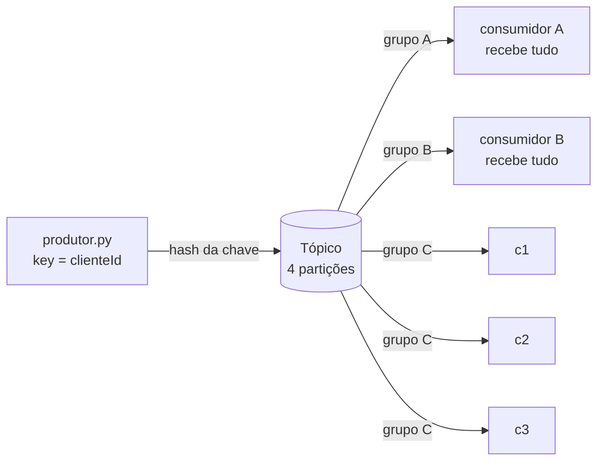

# lab-u3-kafka Implementation Plan

> **For agentic workers:** REQUIRED SUB-SKILL: Use superpowers:subagent-driven-development (recommended) or superpowers:executing-plans to implement this plan task-by-task. Steps use checkbox (`- [ ]`) syntax for tracking.

**Goal:** Entregar a trilha Kafka local da Unidade 3: um broker Kafka em Docker, um produtor e um consumidor em Python e três demonstrações (roteamento por chave, consumer groups com rebalanceamento, reentrega at-least-once), sem conta AWS.

**Architecture:** O diretório `lab-u3-kafka/` é autocontido. A lógica pura (validação de evento e regra de falha) fica em `src/suporte.py` e é testada com pytest sem broker. O produtor e o consumidor usam `confluent-kafka` contra um broker Kafka em modo KRaft de um nó. Cada script de demonstração cria um tópico próprio, orquestra processos em segundo plano e imprime uma saída didática no padrão dos labs existentes.

**Tech Stack:** Python 3.14 (do `.venv` do repositório), `confluent-kafka` 2.16.0, pytest, Docker Compose, imagem `apache/kafka:4.2.2`, Bash, GNU Make.

**Spec:** [docs/superpowers/specs/2026-10-13-lab-u3-kafka-design.md](../specs/2026-10-13-lab-u3-kafka-design.md), incluindo a seção 9 (refinamentos definidos neste plano).

## Global Constraints

- Cliente Python: `confluent-kafka==2.16.0`. Imagem: `apache/kafka:4.2.2`, modo KRaft, um nó, container `u3kafka-broker`.
- Tópico de uso manual: `u3kafka-eventos-suporte`, 4 partições, fator de replicação 1. Os scripts usam tópicos próprios `u3kafka-<demo>-<pid>`, apagados ao final.
- Listener anunciado como `localhost:9092`, para clientes executados no host.
- `lab-u3-01`, `lab-u3-02`, `lab-u3-03` e os alvos `LOCALSTACK=1` do Makefile não são alterados.
- `suporte.py` não importa `confluent_kafka`, e o pytest de `lab-u3-kafka` roda sem broker e sem Docker.
- Variáveis de ambiente do consumidor: `GRUPO` (obrigatória), `CONSUMIDOR`, `FALHAR_EM`, `KAFKA_BOOTSTRAP` e `TOPICO`. O produtor aceita `KAFKA_BOOTSTRAP` e `TOPICO`.
- Marcadores de saída do consumidor: `[ATRIBUIDO]`, `[REVOGADO]`, `[PROCESSADO]`, `[FALHA]`.
- Texto em português brasileiro com acentuação completa. Em Markdown, voz impessoal, sem ponto e vírgula, sem idiomatismo e sem parágrafo que termine em frase de efeito.
- Scripts em `#!/usr/bin/env bash` compatível com o Bash 3.2 do macOS (sem arrays associativos e sem `wait -n`).
- Cada commit termina com a linha `Co-Authored-By: Claude Sonnet 5.5 <noreply@anthropic.com>`.

**Pré-requisito do ambiente:** o daemon do Docker precisa estar em execução, o que neste computador significa rodar `colima start`, e a conferência é `docker info --format '{{.ServerVersion}}'`. As Tasks 2 a 5 e o passo de captura de saída da Task 6 exigem o Docker, e a Task 1 roda sem ele.

## Review Focus

Entradas e condições que o spec implica, que nenhum teste de caminho feliz cobre, em ordem de probabilidade:

1. `clienteId` que não é texto (por exemplo, o número `123`): o produtor deve recusar com mensagem clara e código de saída 2, pois a chave de uma mensagem Kafka precisa ser texto. Fixado na Task 1 (teste) e verificado na Task 3 (comando).
2. Lote vazio (`[]`): o produtor deve recusar com código de saída 2, e não terminar em silêncio sem publicar. Fixado na Task 1 e verificado na Task 3.
3. JSON malformado ou entrada vazia: o produtor deve recusar com código de saída 2 e indicar que o JSON está malformado. Verificado na Task 3.
4. Broker indisponível: o produtor deve terminar em cerca de 10 a 15 segundos com `falhas` maior que zero e código de saída 1, sem ficar bloqueado nos 300 segundos padrão do `librdkafka`. Verificado na Task 3 (`message.timeout.ms=10000`).
5. Execução repetida de uma demonstração: a segunda execução deve produzir as mesmas conclusões, sem herdar eventos ou offsets da primeira. Garantido pelos tópicos por execução e verificado nas Tasks 3, 4 e 5 (cada demonstração roda duas vezes).

Condições adicionais cobertas dentro das tasks: valor de mensagem que não é JSON (o consumidor ignora e confirma, Task 4) e interrupção por SIGTERM durante a demonstração (o consumidor deixa o grupo, Task 4).

---

### Task 1: Lógica pura (`suporte.py`) e alvo `test-kafka`

**Files:**
- Create: `lab-u3-kafka/src/suporte.py`
- Create: `lab-u3-kafka/tests/conftest.py`
- Create: `lab-u3-kafka/tests/test_suporte.py`
- Modify: `Makefile` (variável `LABU3K`, `.PHONY`, agregado `test`, bloco `help`, alvo `test-kafka`)

**Interfaces:**
- Produces: `suporte.EventoInvalido(ValueError)`, `suporte.montar_evento(bruto: object) -> dict` (devolve `{"clienteId": str, "mensagem": str}`), `suporte.montar_lote(bruto: object) -> list[dict]`, `suporte.deve_falhar(cliente_id: object, falhar_em: str) -> bool`. As Tasks 3 e 4 importam esses nomes.

- [ ] **Step 1: Escrever o conftest e os testes que falham**

Criar `lab-u3-kafka/tests/conftest.py`:

```python
"""Configuração do pytest para o lab Kafka local."""

import pathlib
import sys

SRC = pathlib.Path(__file__).resolve().parent.parent / "src"
sys.path.insert(0, str(SRC))
```

Criar `lab-u3-kafka/tests/test_suporte.py`:

```python
"""Testes da lógica pura do lab Kafka local — rodam sem broker e sem Docker."""

import pytest

from suporte import EventoInvalido, deve_falhar, montar_evento, montar_lote


# ---------------------------------------------------------------------------
# montar_evento
# ---------------------------------------------------------------------------

def test_monta_evento_valido():
    assert montar_evento({"clienteId": "cli-001", "mensagem": "oi"}) == {
        "clienteId": "cli-001",
        "mensagem": "oi",
    }


def test_descarta_campos_extras():
    evento = montar_evento({"clienteId": "cli-001", "mensagem": "oi", "extra": 1})
    assert set(evento) == {"clienteId", "mensagem"}


@pytest.mark.parametrize("bruto", ["texto", 5, None, [1, 2]])
def test_evento_que_nao_e_objeto_e_rejeitado(bruto):
    with pytest.raises(EventoInvalido, match="objeto"):
        montar_evento(bruto)


def test_cliente_id_ausente_e_rejeitado():
    with pytest.raises(EventoInvalido, match="clienteId"):
        montar_evento({"mensagem": "oi"})


def test_cliente_id_vazio_e_rejeitado():
    with pytest.raises(EventoInvalido, match="clienteId"):
        montar_evento({"clienteId": "", "mensagem": "oi"})


def test_cliente_id_que_nao_e_texto_e_rejeitado():
    with pytest.raises(EventoInvalido, match="texto"):
        montar_evento({"clienteId": 123, "mensagem": "oi"})


def test_mensagem_ausente_e_rejeitada():
    with pytest.raises(EventoInvalido, match="mensagem"):
        montar_evento({"clienteId": "cli-001"})


def test_mensagem_com_acentos_e_preservada():
    evento = montar_evento({"clienteId": "cli-001", "mensagem": "não consigo logar"})
    assert evento["mensagem"] == "não consigo logar"


# ---------------------------------------------------------------------------
# montar_lote
# ---------------------------------------------------------------------------

def test_objeto_unico_vira_lote_de_um():
    lote = montar_lote({"clienteId": "cli-001", "mensagem": "oi"})
    assert lote == [{"clienteId": "cli-001", "mensagem": "oi"}]


def test_lista_preserva_a_ordem():
    lote = montar_lote([
        {"clienteId": "cli-002", "mensagem": "b"},
        {"clienteId": "cli-001", "mensagem": "a"},
    ])
    assert [e["clienteId"] for e in lote] == ["cli-002", "cli-001"]


def test_lote_vazio_e_rejeitado():
    with pytest.raises(EventoInvalido, match="vazio"):
        montar_lote([])


def test_um_evento_invalido_rejeita_o_lote_inteiro():
    with pytest.raises(EventoInvalido):
        montar_lote([
            {"clienteId": "cli-001", "mensagem": "ok"},
            {"clienteId": "cli-002"},
        ])


# ---------------------------------------------------------------------------
# deve_falhar
# ---------------------------------------------------------------------------

def test_falha_quando_o_cliente_coincide():
    assert deve_falhar("cli-002", "cli-002") is True


def test_nao_falha_quando_o_cliente_difere():
    assert deve_falhar("cli-001", "cli-002") is False


def test_nao_falha_quando_falhar_em_e_vazio():
    assert deve_falhar("cli-001", "") is False


def test_cliente_ausente_com_falhar_em_vazio_nao_falha():
    assert deve_falhar(None, "") is False
```

- [ ] **Step 2: Rodar os testes e confirmar a falha**

Run: `cd lab-u3-kafka && ../.venv/bin/pytest -q`
Expected: erro de coleta `ModuleNotFoundError: No module named 'suporte'`.

- [ ] **Step 3: Implementar `suporte.py`**

Criar `lab-u3-kafka/src/suporte.py`:

```python
"""Lógica pura do lab Kafka local — sem I/O e sem importar confluent_kafka.

`montar_evento` é cópia adaptada de lab-u3-01/src/suporte.py: o lab fica
independente do U3-LAB01. A adaptação exige `clienteId` em texto, porque a
chave de uma mensagem Kafka precisa ser texto ou bytes.
"""


class EventoInvalido(ValueError):
    pass


def montar_evento(bruto):
    """Normaliza um evento de suporte cru. Exige a chave de roteamento."""
    if not isinstance(bruto, dict):
        raise EventoInvalido("evento deve ser um objeto")
    cliente_id = bruto.get("clienteId")
    mensagem = bruto.get("mensagem")
    if not cliente_id:
        raise EventoInvalido("clienteId é obrigatório (é a chave de roteamento)")
    if not isinstance(cliente_id, str):
        raise EventoInvalido("clienteId deve ser texto")
    if not mensagem:
        raise EventoInvalido("mensagem é obrigatória")
    return {"clienteId": cliente_id, "mensagem": mensagem}


def montar_lote(bruto):
    """Aceita um evento ou uma lista e devolve a lista de eventos validados."""
    eventos = bruto if isinstance(bruto, list) else [bruto]
    if not eventos:
        raise EventoInvalido("o lote está vazio")
    return [montar_evento(e) for e in eventos]


def deve_falhar(cliente_id, falhar_em):
    """Regra da falha intencional: só falha quando `falhar_em` está definido
    e coincide com o clienteId do registro."""
    return bool(falhar_em) and cliente_id == falhar_em
```

- [ ] **Step 4: Rodar os testes e confirmar que passam**

Run: `cd lab-u3-kafka && ../.venv/bin/pytest -q`
Expected: `19 passed`.

- [ ] **Step 5: Ligar o lab ao Makefile**

Em `Makefile`, aplicar cinco edições:

1. Depois da linha `LABU303    := lab-u3-03`, inserir:

```make
LABU3K     := lab-u3-kafka
```

2. Na lista `.PHONY`, trocar a linha `        test-produtor test-consumidor test-classificador \` por:

```make
        test-produtor test-consumidor test-classificador test-kafka \
        kafka-up kafka-down kafka-rotear kafka-grupos kafka-reentrega \
```

3. No alvo agregado `test`, trocar `test-eventstore test-snapshots test-cqrs test-produtor test-consumidor test-classificador` por `test-eventstore test-snapshots test-cqrs test-produtor test-consumidor test-classificador test-kafka`.

4. No bloco `help`, depois da linha `@echo "    test-classificador pytest do classificador IA+cache (U3-LAB03)"`, inserir:

```make
	@echo "    test-kafka         pytest do lab Kafka local (U3, trilha Docker)"
```

5. Depois do alvo `test-classificador`, inserir:

```make
test-kafka: $(PYTEST)
	@echo "▶ U3-KAFKA — pytest (validação de evento, lote e regra de falha)"
	cd $(LABU3K) && $(PYTEST) -q
```

- [ ] **Step 6: Rodar o alvo**

Run: `make test-kafka`
Expected: linha `▶ U3-KAFKA — pytest ...` seguida de `19 passed`.

- [ ] **Step 7: Commit**

```bash
git add lab-u3-kafka Makefile
git commit -m "feat(u3-kafka): lógica pura do lab Kafka local e alvo test-kafka

Co-Authored-By: Claude Sonnet 5.5 <noreply@anthropic.com>"
```

---

### Task 2: Broker Kafka em Docker (`compose.yaml`, `kafka-up`, `kafka-down`)

**Files:**
- Create: `lab-u3-kafka/compose.yaml`
- Modify: `Makefile` (variável `KAFKA_COMPOSE`, bloco de alvos Kafka, linhas de `help`)

**Interfaces:**
- Produces: container `u3kafka-broker` com o broker em `localhost:9092`, tópico `u3kafka-eventos-suporte` com 4 partições, e os alvos `kafka-up` e `kafka-down`. As Tasks 3 a 5 assumem o container com esse nome e o executável `/opt/kafka/bin/kafka-topics.sh` dentro dele.

- [ ] **Step 1: Confirmar que o Docker responde**

Run: `docker info --format '{{.ServerVersion}}'`
Expected: um número de versão. Se aparecer `Cannot connect to the Docker daemon`, rodar `colima start` e repetir.

- [ ] **Step 2: Escrever `compose.yaml`**

Criar `lab-u3-kafka/compose.yaml`:

```yaml
name: u3kafka

services:
  kafka:
    image: apache/kafka:4.2.2
    container_name: u3kafka-broker
    ports:
      - "9092:9092"
    environment:
      KAFKA_NODE_ID: 1
      KAFKA_PROCESS_ROLES: broker,controller
      KAFKA_LISTENERS: PLAINTEXT://:9092,CONTROLLER://:9093
      KAFKA_ADVERTISED_LISTENERS: PLAINTEXT://localhost:9092
      KAFKA_CONTROLLER_LISTENER_NAMES: CONTROLLER
      KAFKA_LISTENER_SECURITY_PROTOCOL_MAP: CONTROLLER:PLAINTEXT,PLAINTEXT:PLAINTEXT
      KAFKA_CONTROLLER_QUORUM_VOTERS: 1@localhost:9093
      KAFKA_OFFSETS_TOPIC_REPLICATION_FACTOR: 1
      KAFKA_TRANSACTION_STATE_LOG_REPLICATION_FACTOR: 1
      KAFKA_TRANSACTION_STATE_LOG_MIN_ISR: 1
      KAFKA_GROUP_INITIAL_REBALANCE_DELAY_MS: 0
      KAFKA_NUM_PARTITIONS: 4
    volumes:
      - u3kafka-dados:/var/lib/kafka/data
    healthcheck:
      test: ["CMD-SHELL", "/opt/kafka/bin/kafka-broker-api-versions.sh --bootstrap-server localhost:9092 > /dev/null 2>&1"]
      interval: 5s
      timeout: 10s
      retries: 20
      start_period: 10s

  # Serviço de uso único: compartilha a rede do broker, então `localhost:9092`
  # (o endereço anunciado) funciona aqui dentro sem um segundo listener.
  criar-topico:
    image: apache/kafka:4.2.2
    network_mode: "service:kafka"
    depends_on:
      kafka:
        condition: service_healthy
    restart: "no"
    command:
      - /opt/kafka/bin/kafka-topics.sh
      - --bootstrap-server
      - localhost:9092
      - --create
      - --if-not-exists
      - --topic
      - u3kafka-eventos-suporte
      - --partitions
      - "4"
      - --replication-factor
      - "1"

volumes:
  u3kafka-dados:
```

- [ ] **Step 3: Validar a sintaxe do Compose**

Run: `docker compose -f lab-u3-kafka/compose.yaml config --quiet && echo ok`
Expected: `ok`.

- [ ] **Step 4: Adicionar os alvos ao Makefile**

Em `Makefile`, inserir o bloco abaixo imediatamente antes do banner `# LocalStack — opcional, para as Partes 1-3 sem conta AWS` (o banner são três linhas de comentário, e o bloco novo entra antes da primeira delas):

```make
# ==========================================================================
# Kafka local (Docker) — trilha complementar da Unidade 3, sem AWS
# ==========================================================================
KAFKA_COMPOSE := docker compose -f $(LABU3K)/compose.yaml

kafka-up:
	$(KAFKA_COMPOSE) up -d --wait kafka
	$(KAFKA_COMPOSE) run --rm criar-topico
	@echo "Kafka em localhost:9092, tópico u3kafka-eventos-suporte (4 partições)."
	@echo "Demos: make kafka-rotear | make kafka-grupos | make kafka-reentrega"

kafka-down:
	$(KAFKA_COMPOSE) down -v

```

No bloco `help`, antes da linha `@echo "  LocalStack (opcional, Partes 1-3):"`, inserir:

```make
	@echo "  Kafka local (Docker, sem AWS):"
	@echo "    kafka-up           Sobe o broker Kafka e cria o tópico (4 partições)"
	@echo "    kafka-down         Derruba o broker e apaga os dados"
	@echo ""
```

- [ ] **Step 5: Subir o broker e verificar**

Run: `make kafka-up`
Expected: o Compose baixa a imagem na primeira vez, o container `u3kafka-broker` fica `healthy`, e a execução de `criar-topico` imprime `Created topic u3kafka-eventos-suporte.`. As duas últimas linhas do alvo aparecem.

Run: `docker image inspect apache/kafka:4.2.2 --format '{{.Architecture}}'`
Expected: `arm64` em um Mac com Apple Silicon. Se aparecer `amd64`, o broker roda sob emulação, e o tempo de subida pode passar de 60 segundos (registrar isso na seção Pontos de atenção da Task 6).

Run: `docker exec u3kafka-broker /opt/kafka/bin/kafka-topics.sh --bootstrap-server localhost:9092 --describe --topic u3kafka-eventos-suporte`
Expected: linha com `PartitionCount: 4` e `ReplicationFactor: 1`, e quatro linhas `Partition: 0` a `Partition: 3`.

Run: `nc -z localhost 9092 && echo alcançável`
Expected: `alcançável` (confirma o listener anunciado para clientes do host).

- [ ] **Step 6: Verificar idempotência e limpeza**

Run: `make kafka-up` (segunda vez, com o broker já no ar)
Expected: conclui sem erro, e `criar-topico` não falha por tópico existente (`--if-not-exists`).

Run: `make kafka-down && docker ps -a --filter name=u3kafka --format '{{.Names}}' && docker volume ls --format '{{.Name}}' | grep u3kafka || echo "limpo"`
Expected: a saída termina em `limpo` (nenhum container e nenhum volume `u3kafka`).

Contingência, somente se `run --rm criar-topico` falhar por causa de `network_mode: "service:kafka"`: remover o serviço `criar-topico` do `compose.yaml`, trocar a linha `$(KAFKA_COMPOSE) run --rm criar-topico` do alvo `kafka-up` por `docker exec u3kafka-broker /opt/kafka/bin/kafka-topics.sh --bootstrap-server localhost:9092 --create --if-not-exists --topic u3kafka-eventos-suporte --partitions 4 --replication-factor 1`, e registrar a troca na seção 9 do spec.

- [ ] **Step 7: Commit**

```bash
git add lab-u3-kafka/compose.yaml Makefile
git commit -m "feat(u3-kafka): broker Kafka em Docker e alvos kafka-up e kafka-down

Co-Authored-By: Claude Sonnet 5.5 <noreply@anthropic.com>"
```

---

### Task 3: Produtor e demonstração de roteamento por chave

**Files:**
- Create: `lab-u3-kafka/requirements.txt`
- Create: `lab-u3-kafka/src/produtor.py`
- Create: `lab-u3-kafka/scripts/comum.sh`
- Create: `lab-u3-kafka/scripts/rotear-por-chave.sh`
- Modify: `Makefile` (regra `KAFKA_DEPS`, alvo `kafka-rotear`, linha de `help`)

**Interfaces:**
- Consumes: `suporte.montar_lote`, `suporte.EventoInvalido` (Task 1). Container `u3kafka-broker` (Task 2).
- Produces: `produtor.py`, que lê JSON do primeiro argumento ou da entrada padrão, usa as variáveis `KAFKA_BOOTSTRAP` e `TOPICO`, imprime em stdout uma linha JSON `{"publicados": [{"clienteId", "particao", "offset"} | {"clienteId", "erro"}], "falhas": N}` e sai com 0 (sucesso), 1 (falha de entrega) ou 2 (entrada inválida). `scripts/comum.sh`, que as Tasks 4 e 5 carregam com `source` e que define: `titulo`, `nota`, `linha`, `kafka_cli <ferramenta> <args...>`, `exigir_broker`, `criar_topico <nome>`, `apagar_topico <nome>`, `esperar_linhas <arquivo> <padrão> <mínimo> <segundos>`, `esperar_fim <pid> <segundos>` e `encerrar <pid>...`. Regra `$(KAFKA_DEPS)` do Makefile, da qual as Tasks 4 e 5 dependem.

- [ ] **Step 1: Declarar a dependência e instalar no `.venv`**

Criar `lab-u3-kafka/requirements.txt`:

```
confluent-kafka==2.16.0
```

Run: `.venv/bin/pip install -q -r lab-u3-kafka/requirements.txt && .venv/bin/python -c "import confluent_kafka; print(confluent_kafka.version())"`
Expected: `('2.16.0', ...)`. Se a instalação falhar por falta de wheel, registrar a mensagem e a plataforma e interromper a execução do plano, porque a dependência é premissa do spec.

- [ ] **Step 2: Adicionar a regra de dependências e o alvo ao Makefile**

Dentro do bloco `Kafka local`, depois de `KAFKA_COMPOSE := ...`, inserir:

```make
# Instala o cliente Kafka no .venv só quando o requirements.txt muda.
KAFKA_DEPS := $(VENV)/.kafka-deps

$(KAFKA_DEPS): $(LABU3K)/requirements.txt | $(PYTEST)
	$(VENV)/bin/pip install -q -r $(LABU3K)/requirements.txt
	touch $@
```

Depois do alvo `kafka-down`, inserir:

```make
kafka-rotear: $(KAFKA_DEPS)
	cd $(LABU3K)/scripts && bash rotear-por-chave.sh

```

No `help`, depois da linha `kafka-up`, inserir:

```make
	@echo "    kafka-rotear       Roteamento por chave de partição (mesma chave, mesma partição)"
```

- [ ] **Step 3: Escrever `produtor.py`**

Criar `lab-u3-kafka/src/produtor.py`:

```python
"""Produtor Kafka local — publica eventos de suporte com key=clienteId.

Entrada: um evento ou uma lista, em JSON, pelo primeiro argumento ou pela
entrada padrão. Saída (stdout): uma linha JSON com a partição e o offset de
cada registro, ou o erro de entrega.

Variáveis: KAFKA_BOOTSTRAP (padrão localhost:9092) e TOPICO (padrão
u3kafka-eventos-suporte). Códigos de saída: 0 ok, 1 falha de entrega,
2 entrada inválida.
"""

import json
import os
import sys

from confluent_kafka import Producer

from suporte import EventoInvalido, montar_lote

BOOTSTRAP = os.environ.get("KAFKA_BOOTSTRAP", "localhost:9092")
TOPICO = os.environ.get("TOPICO", "u3kafka-eventos-suporte")


def main(argv, entrada):
    texto = argv[1] if len(argv) > 1 else entrada.read()
    try:
        eventos = montar_lote(json.loads(texto))
    except json.JSONDecodeError as erro:
        print(f"entrada inválida: JSON malformado ({erro})", file=sys.stderr)
        return 2
    except EventoInvalido as erro:
        print(f"entrada inválida: {erro}", file=sys.stderr)
        return 2

    # message.timeout.ms curto: com o broker fora do ar, a falha aparece em
    # ~10 s em vez dos 300 s padrão do librdkafka.
    producer = Producer({"bootstrap.servers": BOOTSTRAP, "message.timeout.ms": 10000})
    publicados = [None] * len(eventos)

    def ao_entregar(indice, evento):
        def callback(erro, msg):
            if erro is not None:
                publicados[indice] = {"clienteId": evento["clienteId"], "erro": str(erro)}
            else:
                publicados[indice] = {
                    "clienteId": evento["clienteId"],
                    "particao": msg.partition(),
                    "offset": msg.offset(),
                }
        return callback

    for i, evento in enumerate(eventos):
        # A key é o clienteId: o particionador do cliente calcula o hash da
        # chave e fixa a partição de destino.
        producer.produce(
            TOPICO,
            key=evento["clienteId"],
            value=json.dumps(evento, ensure_ascii=False),
            on_delivery=ao_entregar(i, evento),
        )
    producer.flush(30)

    for i, resultado in enumerate(publicados):
        if resultado is None:
            publicados[i] = {"clienteId": eventos[i]["clienteId"], "erro": "sem confirmação do broker"}

    falhas = sum(1 for r in publicados if "erro" in r)
    print(json.dumps({"publicados": publicados, "falhas": falhas}, ensure_ascii=False))
    return 1 if falhas else 0


if __name__ == "__main__":
    sys.exit(main(sys.argv, sys.stdin))
```

- [ ] **Step 4: Verificar as recusas de entrada (não exige broker)**

Run: `echo '[]' | .venv/bin/python lab-u3-kafka/src/produtor.py; echo "exit=$?"`
Expected: `entrada inválida: o lote está vazio` em stderr e `exit=2`.

Run: `.venv/bin/python lab-u3-kafka/src/produtor.py '{nao-e-json'; echo "exit=$?"`
Expected: `entrada inválida: JSON malformado (...)` e `exit=2`.

Run: `.venv/bin/python lab-u3-kafka/src/produtor.py '{"clienteId":123,"mensagem":"x"}'; echo "exit=$?"`
Expected: `entrada inválida: clienteId deve ser texto` e `exit=2`.

Run: `printf '' | .venv/bin/python lab-u3-kafka/src/produtor.py; echo "exit=$?"`
Expected: `entrada inválida: JSON malformado (...)` e `exit=2`.

- [ ] **Step 5: Verificar o comportamento com broker indisponível**

Run: `time (KAFKA_BOOTSTRAP=localhost:1 .venv/bin/python lab-u3-kafka/src/produtor.py '{"clienteId":"cli-001","mensagem":"oi"}'; echo "exit=$?")`
Expected: uma linha JSON com `"falhas": 1` e um campo `erro` no registro, `exit=1`, e tempo total entre 10 e 20 segundos.

- [ ] **Step 6: Escrever `comum.sh`**

Criar `lab-u3-kafka/scripts/comum.sh`:

```bash
# comum.sh — funções compartilhadas pelos scripts de demonstração (use com `source`).

BROKER_CONTAINER="u3kafka-broker"
KAFKA_BIN="/opt/kafka/bin"

titulo() { printf '\n▶ %s\n' "$1"; }
nota()   { printf '  %s\n' "$1"; }
linha()  { printf '%s\n' '───────────────────────────────────────────────────────────────────'; }

# kafka_cli <ferramenta> <args...> — roda uma ferramenta do Kafka dentro do container.
kafka_cli() {
  local ferramenta="$1"
  shift
  docker exec "$BROKER_CONTAINER" "$KAFKA_BIN/$ferramenta" --bootstrap-server localhost:9092 "$@"
}

exigir_broker() {
  if ! docker exec "$BROKER_CONTAINER" true >/dev/null 2>&1; then
    echo "Broker não encontrado. Rode 'make kafka-up' antes." >&2
    exit 1
  fi
}

criar_topico() {
  kafka_cli kafka-topics.sh --create --if-not-exists --topic "$1" --partitions 4 --replication-factor 1 >/dev/null
}

apagar_topico() {
  kafka_cli kafka-topics.sh --delete --if-exists --topic "$1" >/dev/null 2>&1 || true
}

# esperar_linhas <arquivo> <padrão> <mínimo> <segundos> — espera o padrão
# aparecer ao menos <mínimo> vezes no arquivo. Devolve 1 se o tempo estourar.
esperar_linhas() {
  local arquivo="$1" padrao="$2" minimo="$3" limite="$4" i=0 n
  while [ "$i" -lt "$((limite * 2))" ]; do
    n="$(grep -c -- "$padrao" "$arquivo" 2>/dev/null || true)"
    n="${n:-0}"
    if [ "$n" -ge "$minimo" ]; then
      return 0
    fi
    sleep 0.5
    i=$((i + 1))
  done
  echo "tempo esgotado esperando '$padrao' em $arquivo" >&2
  return 1
}

# esperar_fim <pid> <segundos> — espera o processo terminar sozinho.
# Devolve 1 se o tempo estourar.
esperar_fim() {
  local pid="$1" limite="$2" i=0
  while kill -0 "$pid" 2>/dev/null; do
    if [ "$i" -ge "$((limite * 2))" ]; then
      return 1
    fi
    sleep 0.5
    i=$((i + 1))
  done
  return 0
}

# encerrar <pid>... — envia SIGTERM e espera. O consumidor trata o sinal e deixa
# o grupo antes de sair, o que dispara o rebalanceamento dos demais membros.
encerrar() {
  local pid
  for pid in "$@"; do
    kill -TERM "$pid" 2>/dev/null || true
  done
  for pid in "$@"; do
    wait "$pid" 2>/dev/null || true
  done
}
```

- [ ] **Step 7: Escrever `rotear-por-chave.sh`**

Criar `lab-u3-kafka/scripts/rotear-por-chave.sh`:

```bash
#!/usr/bin/env bash
#
# rotear-por-chave.sh — publica eventos de três clientes e mostra que cada
# clienteId cai sempre na MESMA partição (ordenação por cliente), enquanto
# clientes diferentes se distribuem entre as partições. É o roteamento por
# hash da chave, agora em Kafka real (espelha o U3-LAB01).
#
# Requer: broker no ar (make kafka-up).
# Uso:    ./rotear-por-chave.sh

set -euo pipefail

AQUI="$(cd "$(dirname "$0")" && pwd)"
SRC="$AQUI/../src"
# shellcheck source=comum.sh
source "$AQUI/comum.sh"

exigir_broker

TOPICO="u3kafka-rotear-$$"
criar_topico "$TOPICO"
trap 'apagar_topico "$TOPICO"' EXIT

LOTE='[
  {"clienteId":"cli-001","mensagem":"nao consigo logar"},
  {"clienteId":"cli-002","mensagem":"cobranca errada"},
  {"clienteId":"cli-001","mensagem":"segue o print"},
  {"clienteId":"cli-003","mensagem":"elogio ao suporte"},
  {"clienteId":"cli-002","mensagem":"aguardo retorno"},
  {"clienteId":"cli-001","mensagem":"resolvido?"},
  {"clienteId":"cli-003","mensagem":"obrigado"}
]'

linha
echo " U3-KAFKA — roteamento por chave de partição"
linha
echo "O Kafka distribui as mensagens entre as partições do tópico com base num"
echo "hash da chave (aqui, o clienteId). Vamos publicar mensagens de 3 clientes"
echo "intercaladas e conferir que cada cliente SEMPRE cai na mesma partição."
echo "É isso que garante a ordenação por cliente: dentro de uma partição, os"
echo "offsets crescem na ordem em que as mensagens chegaram."

titulo "Publicando 7 eventos (cli-001 x3, cli-002 x2, cli-003 x2) no tópico $TOPICO"
RESP="$(TOPICO="$TOPICO" python3 "$SRC/produtor.py" "$LOTE")"

RESP="$RESP" python3 - <<'PY'
import collections
import json
import os
import sys

d = json.loads(os.environ["RESP"])
if d["falhas"]:
    print("  ✗ houve falhas de entrega:", d["publicados"])
    sys.exit(1)

por_cliente = collections.defaultdict(list)
print()
print("  clienteId  ->  partição  offset")
for r in d["publicados"]:
    print(f"  {r['clienteId']}   ->  {r['particao']}          {r['offset']}")
    por_cliente[r["clienteId"]].append((r["particao"], r["offset"]))

print()
print("  resumo por cliente:")
todos_ok = True
for cliente, itens in sorted(por_cliente.items()):
    particoes = {p for p, _ in itens}
    offsets = [o for _, o in itens]
    ok = len(particoes) == 1 and offsets == sorted(offsets) and len(set(offsets)) == len(offsets)
    todos_ok = todos_ok and ok
    rotulo = "OK, sempre a mesma partição, offsets crescentes" if ok else "INCONSISTENTE"
    print(f"    {cliente}: {len(particoes)} partição(ões) -> {rotulo}")

usadas = {p for itens in por_cliente.values() for p, _ in itens}
print(f"  partições distintas usadas pelos 3 clientes: {len(usadas)} de 4")
print("  ✓ mesma chave -> mesma partição -> ordenação por cliente" if todos_ok else "  ✗ inesperado")
sys.exit(0 if todos_ok else 1)
PY

linha
echo " A chave de roteamento (clienteId) fixa a partição: ordenação por cliente."
echo " Clientes diferentes podem cair na mesma partição (colisão de hash é normal)"
echo " ou em partições diferentes, e é isso que permite paralelismo entre eles."
linha
```

- [ ] **Step 8: Rodar a demonstração duas vezes**

Run: `make kafka-up && make kafka-rotear`
Expected: a saída contém a tabela `clienteId  ->  partição  offset` com 7 linhas, três linhas de resumo com `OK, sempre a mesma partição, offsets crescentes`, a linha `partições distintas usadas pelos 3 clientes: N de 4` (N entre 1 e 3) e `✓ mesma chave -> mesma partição -> ordenação por cliente`. O código de saída é 0.

Run: `make kafka-rotear`
Expected: as mesmas conclusões e os mesmos offsets iniciais (`0` para o primeiro registro de cada partição), porque cada execução usa um tópico novo.

Run: `docker exec u3kafka-broker /opt/kafka/bin/kafka-topics.sh --bootstrap-server localhost:9092 --list`
Expected: apenas `u3kafka-eventos-suporte` (os tópicos `u3kafka-rotear-*` foram apagados).

- [ ] **Step 9: Commit**

```bash
git add lab-u3-kafka Makefile
git commit -m "feat(u3-kafka): produtor e demonstração de roteamento por chave

Co-Authored-By: Claude Sonnet 5.5 <noreply@anthropic.com>"
```

---

### Task 4: Consumidor e demonstração de grupos e rebalanceamento

**Files:**
- Create: `lab-u3-kafka/src/consumidor.py`
- Create: `lab-u3-kafka/scripts/grupos-e-rebalanceamento.sh`
- Modify: `Makefile` (alvo `kafka-grupos`, linha de `help`)

**Interfaces:**
- Consumes: `suporte.deve_falhar` (Task 1), `produtor.py` e `scripts/comum.sh` (Task 3), regra `$(KAFKA_DEPS)` (Task 3).
- Produces: `consumidor.py`, que lê `GRUPO` (obrigatória), `CONSUMIDOR`, `FALHAR_EM`, `KAFKA_BOOTSTRAP` e `TOPICO`, usa `auto.offset.reset=earliest` e `enable.auto.commit=false`, confirma o offset depois de processar cada registro, imprime linhas com os marcadores `[ATRIBUIDO] consumidor=<c> grupo=<g> particoes=[...]`, `[REVOGADO] ...`, `[PROCESSADO] consumidor=<c> particao=<p> offset=<o> clienteId=<id>` e `[FALHA] consumidor=<c> particao=<p> offset=<o> clienteId=<id> (sem commit)`, e termina com código 0 no SIGTERM, 1 na falha intencional e 2 sem `GRUPO`. A Task 5 usa esse contrato.

- [ ] **Step 1: Escrever `consumidor.py`**

Criar `lab-u3-kafka/src/consumidor.py`:

```python
"""Consumidor Kafka local — lê o tópico como membro de um consumer group.

Variáveis: GRUPO (obrigatória), CONSUMIDOR (rótulo, padrão "consumidor"),
FALHAR_EM (clienteId que provoca falha antes do commit), KAFKA_BOOTSTRAP
(padrão localhost:9092) e TOPICO (padrão u3kafka-eventos-suporte).

Cada linha de saída leva um marcador: [ATRIBUIDO], [REVOGADO], [PROCESSADO],
[FALHA]. O offset só é confirmado (commit) DEPOIS do processamento, e é isso
que dá at-least-once: um registro que falha antes do commit é entregue de novo.
SIGTERM e SIGINT encerram com close(), que faz o consumidor deixar o grupo.
"""

import json
import os
import signal
import sys

from confluent_kafka import Consumer

from suporte import deve_falhar

BOOTSTRAP = os.environ.get("KAFKA_BOOTSTRAP", "localhost:9092")
TOPICO = os.environ.get("TOPICO", "u3kafka-eventos-suporte")
CONSUMIDOR = os.environ.get("CONSUMIDOR", "consumidor")
FALHAR_EM = os.environ.get("FALHAR_EM", "")

parar = False


def _sinalizar_parada(signum, frame):
    global parar
    parar = True


def _particoes(lista):
    return sorted(p.partition for p in lista)


def main():
    grupo = os.environ.get("GRUPO")
    if not grupo:
        print("GRUPO é obrigatória", file=sys.stderr)
        return 2

    signal.signal(signal.SIGTERM, _sinalizar_parada)
    signal.signal(signal.SIGINT, _sinalizar_parada)

    consumer = Consumer({
        "bootstrap.servers": BOOTSTRAP,
        "group.id": grupo,
        "auto.offset.reset": "earliest",
        "enable.auto.commit": False,
    })

    def ao_atribuir(_consumer, particoes):
        print(f"[ATRIBUIDO] consumidor={CONSUMIDOR} grupo={grupo} particoes={_particoes(particoes)}", flush=True)

    def ao_revogar(_consumer, particoes):
        print(f"[REVOGADO] consumidor={CONSUMIDOR} grupo={grupo} particoes={_particoes(particoes)}", flush=True)

    consumer.subscribe([TOPICO], on_assign=ao_atribuir, on_revoke=ao_revogar)

    try:
        while not parar:
            msg = consumer.poll(0.5)
            if msg is None:
                continue
            if msg.error():
                print(f"[ERRO] {msg.error()}", file=sys.stderr, flush=True)
                continue

            posicao = f"particao={msg.partition()} offset={msg.offset()}"
            try:
                evento = json.loads(msg.value().decode("utf-8"))
                cliente_id = evento["clienteId"]
            except (ValueError, KeyError, TypeError):
                # Valor que não é um evento de suporte: ignora e confirma, para
                # não travar a partição.
                print(f"[IGNORADO] consumidor={CONSUMIDOR} {posicao} (valor não é um evento)", flush=True)
                consumer.commit(message=msg, asynchronous=False)
                continue

            if deve_falhar(cliente_id, FALHAR_EM):
                print(f"[FALHA] consumidor={CONSUMIDOR} {posicao} clienteId={cliente_id} (sem commit)", flush=True)
                return 1

            print(f"[PROCESSADO] consumidor={CONSUMIDOR} {posicao} clienteId={cliente_id}", flush=True)
            consumer.commit(message=msg, asynchronous=False)
    finally:
        consumer.close()
    return 0


if __name__ == "__main__":
    sys.exit(main())
```

- [ ] **Step 2: Verificar a recusa sem `GRUPO` (não exige broker)**

Run: `env -u GRUPO .venv/bin/python lab-u3-kafka/src/consumidor.py; echo "exit=$?"`
Expected: `GRUPO é obrigatória` em stderr e `exit=2`.

- [ ] **Step 3: Escrever `grupos-e-rebalanceamento.sh`**

Criar `lab-u3-kafka/scripts/grupos-e-rebalanceamento.sh`:

```bash
#!/usr/bin/env bash
#
# grupos-e-rebalanceamento.sh — demonstra dois conceitos de consumer groups:
#
#   Parte A. Grupos DIFERENTES recebem TODOS os eventos (espelha a Parte 1 do
#            U3-LAB02, onde cada Lambda com seu ESM é um grupo distinto).
#   Parte B. Membros do MESMO grupo dividem as partições, e a divisão é refeita
#            (rebalanceamento) a cada membro que entra: 1 -> 2 -> 3 consumidores.
#            O ESM do Kinesis não expõe isso, o Kafka sim.
#
# Requer: broker no ar (make kafka-up).
# Uso:    ./grupos-e-rebalanceamento.sh

set -euo pipefail

AQUI="$(cd "$(dirname "$0")" && pwd)"
SRC="$AQUI/../src"
# shellcheck source=comum.sh
source "$AQUI/comum.sh"

exigir_broker

TOPICO="u3kafka-grupos-$$"
criar_topico "$TOPICO"
TMP="$(mktemp -d)"
PIDS=""

limpar() {
  if [ -n "$PIDS" ]; then
    # shellcheck disable=SC2086
    encerrar $PIDS
  fi
  apagar_topico "$TOPICO"
  rm -rf "$TMP"
}
trap limpar EXIT

iniciar_consumidor() {  # iniciar_consumidor <rótulo> <grupo> <arquivo-de-log>
  TOPICO="$TOPICO" CONSUMIDOR="$1" GRUPO="$2" python3 "$SRC/consumidor.py" >"$3" 2>&1 &
  PIDS="$PIDS $!"
  LAST_PID=$!
}

linha
echo " U3-KAFKA — consumer groups e rebalanceamento"
linha
echo "No Kafka, um consumer group é um conjunto de consumidores que compartilham"
echo "a leitura de um tópico. Grupos diferentes recebem o tópico inteiro cada um."
echo "Dentro de um grupo, cada partição vai para exatamente um membro, e a divisão"
echo "é refeita sempre que um membro entra ou sai."

titulo "Parte A — dois grupos independentes recebem todos os eventos"
nota "Publicando 5 eventos no tópico $TOPICO…"
TOPICO="$TOPICO" python3 "$SRC/produtor.py" '[
  {"clienteId":"cli-001","mensagem":"nao consigo logar"},
  {"clienteId":"cli-002","mensagem":"cobranca errada"},
  {"clienteId":"cli-001","mensagem":"segue o print"},
  {"clienteId":"cli-003","mensagem":"elogio ao suporte"},
  {"clienteId":"cli-002","mensagem":"aguardo retorno"}
]' | python3 -c "import sys, json; d = json.load(sys.stdin); print('  ' + str(len(d['publicados'])) + ' evento(s) publicados')"

nota "Iniciando um consumidor no grupo A e outro no grupo B…"
iniciar_consumidor "grupo-a" "ga-$$" "$TMP/a.log"; PID_A="$LAST_PID"
iniciar_consumidor "grupo-b" "gb-$$" "$TMP/b.log"; PID_B="$LAST_PID"
esperar_linhas "$TMP/a.log" "PROCESSADO" 5 30
esperar_linhas "$TMP/b.log" "PROCESSADO" 5 30

titulo "Eventos recebidos pelo GRUPO A"
grep "PROCESSADO" "$TMP/a.log" | sed 's/^/  /'
titulo "Eventos recebidos pelo GRUPO B"
grep "PROCESSADO" "$TMP/b.log" | sed 's/^/  /'
nota "Os dois grupos receberam os mesmos 5 eventos: cada grupo lê o tópico inteiro,"
nota "como cada Lambda com seu próprio ESM lê o stream inteiro no Kinesis."

encerrar "$PID_A" "$PID_B"
PIDS=""

titulo "Parte B — um grupo, 1 -> 2 -> 3 consumidores: as 4 partições são redivididas"
GRUPO_REB="reb-$$"

nota "Entra o consumidor c1 (sozinho no grupo)…"
iniciar_consumidor "c1" "$GRUPO_REB" "$TMP/c1.log"; PID_1="$LAST_PID"
esperar_linhas "$TMP/c1.log" "ATRIBUIDO" 1 30
grep "ATRIBUIDO" "$TMP/c1.log" | tail -1 | sed 's/^/  /'

nota "Entra o consumidor c2: o grupo é rebalanceado…"
iniciar_consumidor "c2" "$GRUPO_REB" "$TMP/c2.log"; PID_2="$LAST_PID"
esperar_linhas "$TMP/c2.log" "ATRIBUIDO" 1 30
esperar_linhas "$TMP/c1.log" "ATRIBUIDO" 2 30
grep "ATRIBUIDO" "$TMP/c1.log" | tail -1 | sed 's/^/  /'
grep "ATRIBUIDO" "$TMP/c2.log" | tail -1 | sed 's/^/  /'

nota "Entra o consumidor c3: novo rebalanceamento…"
iniciar_consumidor "c3" "$GRUPO_REB" "$TMP/c3.log"; PID_3="$LAST_PID"
esperar_linhas "$TMP/c3.log" "ATRIBUIDO" 1 30
esperar_linhas "$TMP/c1.log" "ATRIBUIDO" 3 30
esperar_linhas "$TMP/c2.log" "ATRIBUIDO" 2 30

titulo "Atribuição final (última linha [ATRIBUIDO] de cada membro)"
for n in 1 2 3; do
  grep "ATRIBUIDO" "$TMP/c$n.log" | tail -1 | sed 's/^/  /'
done

python3 - "$TMP" <<'PY'
import re
import sys

tmp = sys.argv[1]
por_membro = {}
for n in (1, 2, 3):
    ultima = [l for l in open(f"{tmp}/c{n}.log") if "[ATRIBUIDO]" in l][-1]
    por_membro[n] = set(int(x) for x in re.findall(r"\d+", ultima.split("particoes=")[1]))

todas = set().union(*por_membro.values())
somas = sum(len(v) for v in por_membro.values())
sem_sobreposicao = somas == len(todas)
print()
print(f"  partições atribuídas no total: {sorted(todas)}")
if todas == {0, 1, 2, 3} and sem_sobreposicao:
    print("  ✓ as 4 partições estão divididas entre os 3 membros, sem sobreposição")
else:
    print("  ✗ divisão inesperada")
    sys.exit(1)
PY

encerrar "$PID_1" "$PID_2" "$PID_3"
PIDS=""

linha
echo " Grupos diferentes recebem tudo. Membros do mesmo grupo dividem as partições,"
echo " e a divisão é refeita quando alguém entra. Com 4 partições, o grupo usa no"
echo " máximo 4 membros: o quinto ficaria ocioso."
linha
```

- [ ] **Step 4: Adicionar o alvo ao Makefile**

Depois do alvo `kafka-rotear`, inserir:

```make
kafka-grupos: $(KAFKA_DEPS)
	cd $(LABU3K)/scripts && bash grupos-e-rebalanceamento.sh

```

No `help`, depois da linha `kafka-rotear`, inserir:

```make
	@echo "    kafka-grupos       Consumer groups e rebalanceamento (1, 2 e 3 consumidores)"
```

- [ ] **Step 5: Rodar a demonstração duas vezes**

Run: `make kafka-up && make kafka-grupos`
Expected, na Parte A: duas listas `PROCESSADO` com 5 linhas cada (uma por grupo), com os mesmos `clienteId`. Na Parte B: `[ATRIBUIDO] consumidor=c1 ... particoes=[0, 1, 2, 3]` para c1 sozinho, depois atribuições que dividem as 4 partições entre c1 e c2, e por fim entre c1, c2 e c3, com a linha `✓ as 4 partições estão divididas entre os 3 membros, sem sobreposição`. O código de saída é 0.

Run: `make kafka-grupos`
Expected: as mesmas conclusões (a divisão exata de partições por membro pode diferir entre execuções).

Run: `pgrep -f src/consumidor.py || echo "nenhum consumidor restante"`
Expected: `nenhum consumidor restante` (o `trap` e o `encerrar` não deixam processos órfãos).

Run: `docker exec u3kafka-broker /opt/kafka/bin/kafka-topics.sh --bootstrap-server localhost:9092 --list`
Expected: apenas `u3kafka-eventos-suporte`.

- [ ] **Step 6: Verificar o encerramento limpo por SIGTERM**

Run: `GRUPO=teste-$$ TOPICO=u3kafka-eventos-suporte .venv/bin/python lab-u3-kafka/src/consumidor.py & PID=$!; sleep 6; kill -TERM $PID; wait $PID; echo "exit=$?"`
Expected: uma linha `[ATRIBUIDO] consumidor=consumidor grupo=teste-... particoes=[0, 1, 2, 3]` e `exit=0` (o consumidor trata o sinal, chama `close()` e sai sem traceback).

- [ ] **Step 7: Commit**

```bash
git add lab-u3-kafka Makefile
git commit -m "feat(u3-kafka): consumidor e demonstração de grupos e rebalanceamento

Co-Authored-By: Claude Sonnet 5.5 <noreply@anthropic.com>"
```

---

### Task 5: Demonstração de reentrega at-least-once

**Files:**
- Create: `lab-u3-kafka/scripts/reentrega.sh`
- Modify: `Makefile` (alvo `kafka-reentrega`, linha de `help`)

**Interfaces:**
- Consumes: `consumidor.py` e seus marcadores (Task 4), `produtor.py` e `scripts/comum.sh` (Task 3), `$(KAFKA_DEPS)`.
- Produces: o alvo `make kafka-reentrega`.

- [ ] **Step 1: Escrever `reentrega.sh`**

Criar `lab-u3-kafka/scripts/reentrega.sh`:

```bash
#!/usr/bin/env bash
#
# reentrega.sh — demonstra at-least-once com commit depois do processamento:
# o consumidor falha ao chegar no registro de cli-002, ANTES de confirmar o
# offset. Ao reiniciar no mesmo grupo, o Kafka entrega o registro de novo.
# É o análogo local do retry do ESM no U3-LAB02 (sem o bisect).
#
# Requer: broker no ar (make kafka-up).
# Uso:    ./reentrega.sh

set -euo pipefail

AQUI="$(cd "$(dirname "$0")" && pwd)"
SRC="$AQUI/../src"
# shellcheck source=comum.sh
source "$AQUI/comum.sh"

exigir_broker

TOPICO="u3kafka-reentrega-$$"
GRUPO="ree-$$"
criar_topico "$TOPICO"
TMP="$(mktemp -d)"
PID=""

limpar() {
  if [ -n "$PID" ]; then
    encerrar "$PID"
  fi
  apagar_topico "$TOPICO"
  rm -rf "$TMP"
}
trap limpar EXIT

linha
echo " U3-KAFKA — at-least-once: falha antes do commit e reentrega"
linha
echo "O Kafka guarda, por grupo e partição, o último offset CONFIRMADO. O consumidor"
echo "desta demo só confirma depois de processar. Se ele cair no meio, o próximo"
echo "consumidor do mesmo grupo recomeça do último offset confirmado, e o registro"
echo "que falhou chega de novo. Nenhum registro se perde, e alguns podem repetir."

titulo "Publicando 4 eventos (cli-002 é o que vai provocar a falha)"
TOPICO="$TOPICO" python3 "$SRC/produtor.py" '[
  {"clienteId":"cli-001","mensagem":"ok 1"},
  {"clienteId":"cli-002","mensagem":"vai falhar"},
  {"clienteId":"cli-001","mensagem":"ok 2"},
  {"clienteId":"cli-003","mensagem":"ok 3"}
]' | python3 -c "import sys, json; d = json.load(sys.stdin); print('  ' + str(len(d['publicados'])) + ' evento(s) publicados')"

titulo "Execução 1 — consumidor com FALHAR_EM=cli-002"
TOPICO="$TOPICO" CONSUMIDOR="exec-1" GRUPO="$GRUPO" FALHAR_EM="cli-002" \
  python3 "$SRC/consumidor.py" >"$TMP/run1.log" 2>&1 &
PID=$!
if ! esperar_fim "$PID" 40; then
  echo "O consumidor não falhou no prazo, o que não era esperado." >&2
  exit 1
fi
RC=0
wait "$PID" || RC=$?
PID=""
grep -E "PROCESSADO|FALHA" "$TMP/run1.log" | sed 's/^/  /'
nota "O processo terminou com código $RC: a falha ocorreu antes do commit do cli-002."

FALHA="$(grep "FALHA" "$TMP/run1.log" | head -1 | sed -E 's/.*(particao=[0-9]+ offset=[0-9]+).*/\1/')"
if [ -z "$FALHA" ]; then
  echo "Nenhuma linha [FALHA] encontrada na execução 1." >&2
  exit 1
fi

titulo "Execução 2 — mesmo grupo, sem falha intencional"
TOPICO="$TOPICO" CONSUMIDOR="exec-2" GRUPO="$GRUPO" \
  python3 "$SRC/consumidor.py" >"$TMP/run2.log" 2>&1 &
PID=$!
esperar_linhas "$TMP/run2.log" "PROCESSADO.*clienteId=cli-002" 1 30
sleep 3
encerrar "$PID"
PID=""
grep "PROCESSADO" "$TMP/run2.log" | sed 's/^/  /'

echo
if grep -q "PROCESSADO.*$FALHA" "$TMP/run2.log"; then
  echo "  ✓ o registro de cli-002 ($FALHA) falhou antes do commit e foi entregue de novo"
else
  echo "  ✗ o registro que falhou ($FALHA) não reapareceu na execução 2"
  exit 1
fi

linha
echo " Commit depois do processamento dá at-least-once: o registro que falhou volta."
echo " Registros posteriores na mesma partição também podem voltar, por isso o"
echo " processamento precisa ser idempotente (ver U1-LAB03)."
echo " No Kinesis, o ESM faz esse retry por conta própria, e o"
echo " BisectBatchOnFunctionError isola o registro venenoso dentro do lote."
linha
```

- [ ] **Step 2: Adicionar o alvo ao Makefile**

Depois do alvo `kafka-grupos`, inserir:

```make
kafka-reentrega: $(KAFKA_DEPS)
	cd $(LABU3K)/scripts && bash reentrega.sh

```

No `help`, depois da linha `kafka-grupos`, inserir:

```make
	@echo "    kafka-reentrega    At-least-once: falha antes do commit e reentrega"
```

- [ ] **Step 3: Rodar a demonstração duas vezes**

Run: `make kafka-up && make kafka-reentrega`
Expected: a Execução 1 lista zero ou mais linhas `PROCESSADO` (os registros anteriores ao cli-002 na mesma partição) e uma linha `[FALHA] consumidor=exec-1 particao=<p> offset=<o> clienteId=cli-002 (sem commit)`, seguida de `O processo terminou com código 1`. A Execução 2 lista linhas `PROCESSADO` que incluem `clienteId=cli-002` com a mesma `particao=<p> offset=<o>`. A linha final é `✓ o registro de cli-002 (particao=<p> offset=<o>) falhou antes do commit e foi entregue de novo`, e o código de saída é 0.

Run: `make kafka-reentrega`
Expected: as mesmas conclusões, sem registros herdados da primeira execução.

Run: `pgrep -f src/consumidor.py || echo "nenhum consumidor restante"; docker exec u3kafka-broker /opt/kafka/bin/kafka-topics.sh --bootstrap-server localhost:9092 --list`
Expected: `nenhum consumidor restante` e apenas o tópico `u3kafka-eventos-suporte`.

- [ ] **Step 4: Rodar a suíte completa do lab**

Run: `make test-kafka`
Expected: `19 passed`.

- [ ] **Step 5: Commit**

```bash
git add lab-u3-kafka Makefile
git commit -m "feat(u3-kafka): demonstração de reentrega at-least-once

Co-Authored-By: Claude Sonnet 5.5 <noreply@anthropic.com>"
```

---

### Task 6: Documentação da trilha

**Files:**
- Create: `docs/unidade-3/02-demos/u3-kafka.md`
- Modify: `docs/unidade-3/index.md`
- Modify: `docs/unidade-3/00-comece-aqui/setup-local.md`
- Modify: `docs/unidade-3/01-fundamentos/kinesis-e-ia/3-ponte-kafka-kinesis.md`
- Modify: `docs/unidade-3/02-demos/u3-03.md` (rodapé)
- Modify: `docs/unidade-3/glossario.md`
- Modify: `README.md`

**Interfaces:**
- Consumes: os alvos `kafka-up`, `kafka-rotear`, `kafka-grupos`, `kafka-reentrega`, `kafka-down` e `test-kafka`, e os marcadores de saída do consumidor (Tasks 1 a 5).

- [ ] **Step 1: Capturar a saída real das três demonstrações**

Run: `make kafka-up && make kafka-rotear 2>&1 | tee /tmp/saida-rotear.txt && make kafka-grupos 2>&1 | tee /tmp/saida-grupos.txt && make kafka-reentrega 2>&1 | tee /tmp/saida-reentrega.txt`
Expected: as três demonstrações terminam com sucesso. Os arquivos em `/tmp/saida-*.txt` servem de fonte para os blocos de saída da seção 6 do documento, no passo seguinte. Os valores de partição, offset e a divisão de partições entre membros variam entre execuções, e o documento deve avisar isso.

- [ ] **Step 2: Escrever `u3-kafka.md`**

Criar `docs/unidade-3/02-demos/u3-kafka.md` com a estrutura abaixo. Nos três blocos de código da seção 6 que mostram saída, colar o trecho central da saída real capturada no passo anterior (a tabela de roteamento, as linhas `[ATRIBUIDO]` finais e as linhas `[FALHA]` e `[PROCESSADO]` da reentrega), em lugar do texto de exemplo abaixo, e manter o aviso de variação.

````markdown
# U3-KAFKA — Kafka local em Docker: partições, consumer groups e reentrega

Trilha complementar aos U3-LAB01 e U3-LAB02. Os laboratórios Kinesis rodam na AWS (ou no LocalStack), e esta trilha executa Kafka real em um container Docker, sem conta AWS, para demonstrar os conceitos que os vídeos conceituais da unidade ensinam: chave de partição, consumer groups, rebalanceamento e entrega at-least-once.

## 1. Objetivos de aprendizagem

- **Explicar** por que a mesma chave cai sempre na mesma partição e como os offsets crescem dentro dela.
- **Diferenciar** dois consumer groups (cada um lê o tópico inteiro) de dois consumidores no mesmo grupo (dividem as partições).
- **Observar** o rebalanceamento quando membros entram em um grupo, com 1, 2 e 3 consumidores sobre 4 partições.
- **Demonstrar** at-least-once: o commit do offset depois do processamento e a reentrega do registro que falhou.

Base conceitual: [Ponte: de Kafka para Kinesis](../01-fundamentos/kinesis-e-ia/3-ponte-kafka-kinesis.md) e [Consumidores e at-least-once](../01-fundamentos/2-consumidores-e-at-least-once.md).

## 2. Motivação

Os vídeos conceituais U3V1 a U3V3 ensinam Kafka, e os laboratórios Kinesis cobrem os mesmos conceitos com outro vocabulário. Esta trilha permite executar o próprio Kafka e mostra o rebalanceamento entre instâncias de um mesmo grupo, que o Event Source Mapping do Kinesis não expõe.

| Aspecto | Labs Kinesis (U3-LAB01 e U3-LAB02) | Trilha Kafka local |
|---------|------------------------------------|--------------------|
| Onde roda | AWS ou LocalStack | Docker local |
| Produtor | Lambda atrás de HTTP API | Script Python (`confluent-kafka`) |
| Consumidor | Lambda via ESM | Processo Python dentro de um grupo |
| Paralelismo | `ParallelizationFactor` | Mais consumidores no mesmo grupo |
| At-least-once | Retry do ESM e `BisectBatchOnFunctionError` | Commit depois do processamento e reentrega |
| Custo | AWS (ou LocalStack) | Nenhum |

## 3. Estrutura

```
lab-u3-kafka/
├── compose.yaml            # broker Kafka (KRaft, um nó) + criação do tópico
├── requirements.txt        # confluent-kafka
├── src/
│   ├── suporte.py          # puro: montar_evento, montar_lote, deve_falhar
│   ├── produtor.py         # key=clienteId → partição e offset de cada registro
│   └── consumidor.py       # membro de um grupo, commit depois de processar
├── tests/                  # pytest (sem broker e sem Docker)
└── scripts/
    ├── comum.sh
    ├── rotear-por-chave.sh
    ├── grupos-e-rebalanceamento.sh
    └── reentrega.sh
```

Comandos via [`Makefile`](../../../Makefile) na raiz. Cada demonstração cria um tópico próprio com 4 partições e o apaga ao terminar, de modo que execuções repetidas não herdam eventos nem offsets anteriores.

## 4. Topologia



Dentro do grupo C, cada partição é lida por um único membro, e a divisão é refeita sempre que um membro entra ou sai. Os grupos A e B leem o tópico inteiro de forma independente.

## 5. Código anotado

`suporte.py` é puro, sem `confluent_kafka`, e contém a regra da falha intencional:

```python
def deve_falhar(cliente_id, falhar_em):
    return bool(falhar_em) and cliente_id == falhar_em
```

`produtor.py` usa o `clienteId` como chave da mensagem, e o particionador do cliente calcula a partição a partir do hash dessa chave:

```python
producer.produce(
    TOPICO,
    key=evento["clienteId"],
    value=json.dumps(evento, ensure_ascii=False),
    on_delivery=ao_entregar(i, evento),
)
```

`consumidor.py` confirma o offset depois de processar cada registro, o que dá a semântica at-least-once:

```python
if deve_falhar(cliente_id, FALHAR_EM):
    print(f"[FALHA] ... (sem commit)", flush=True)
    return 1

print(f"[PROCESSADO] ...", flush=True)
consumer.commit(message=msg, asynchronous=False)
```

Com `enable.auto.commit=false`, nenhum offset é confirmado automaticamente, e um registro que falha antes da linha `commit` volta na próxima execução do mesmo grupo.

## 6. Rodar e observar

```bash
make kafka-up         # sobe o broker e cria o tópico u3kafka-eventos-suporte
make kafka-rotear     # roteamento por chave
make kafka-grupos     # consumer groups e rebalanceamento
make kafka-reentrega  # at-least-once com reentrega
make kafka-down       # derruba o broker e apaga os dados
```

O `make` instala o `confluent-kafka` no `.venv` na primeira execução. Os valores de partição, offset e a divisão de partições entre os membros variam entre execuções.

**Roteamento por chave.** A saída mostra a partição e o offset de cada registro e confirma que cada cliente usa uma única partição:

```
<trecho real de make kafka-rotear: tabela e resumo por cliente>
```

**Grupos e rebalanceamento.** A Parte A mostra os grupos A e B recebendo os mesmos 5 eventos. A Parte B mostra a atribuição final, com as 4 partições divididas entre c1, c2 e c3:

```
<trecho real de make kafka-grupos: linhas [ATRIBUIDO] finais e a verificação>
```

**Reentrega.** A execução 1 termina com `[FALHA]` no registro de cli-002, e a execução 2, no mesmo grupo, processa esse mesmo registro:

```
<trecho real de make kafka-reentrega: [FALHA], [PROCESSADO] e a linha de verificação>
```

## 7. Pontos de atenção

| Sintoma | Causa | O que saber |
|---------|-------|-------------|
| Dois clientes na mesma partição | O hash da chave pode colidir | Normal com 4 partições. A distinção entre clientes é probabilística. |
| Um membro novo demora a receber partições | Rebalanceamento do grupo | Durante o rebalanceamento, os membros revogam e recebem as partições de novo. |
| O quinto consumidor do grupo não recebe nada | Cada partição tem um único membro por grupo | Com 4 partições, o grupo usa no máximo 4 membros. |
| O registro que falhou volta, e os seguintes também | O commit é por offset, e a partição recomeça do último offset confirmado | Por isso o processamento precisa ser idempotente. |
| `make kafka-up` não conecta | Docker ou Colima parado | Rodar `colima start` (ou abrir o Docker Desktop) e repetir. |
| Porta 9092 ocupada | Outro processo usa a porta | Parar o processo ou o broker anterior com `make kafka-down`. |

## 8. Checklist de compreensão

- [ ] Explico por que a chave `clienteId` fixa a partição e garante a ordem por cliente.
- [ ] Diferencio dois grupos distintos de dois membros do mesmo grupo.
- [ ] Descrevo o que acontece com as partições quando um terceiro consumidor entra no grupo.
- [ ] Explico por que confirmar o offset depois de processar produz at-least-once.
- [ ] Relaciono o rebalanceamento do Kafka ao `ParallelizationFactor` e aos múltiplos ESMs do Kinesis.

## 9. Limpeza

```bash
make kafka-down    # derruba o container e remove o volume com os dados
```

## 10. Referências

- Documentação Apache Kafka: "Consumer Groups" e "Message Delivery Semantics".
- Documentação do `confluent-kafka-python`.
- *Designing Data-Intensive Applications*, Kleppmann, cap. 11 (stream processing).

---

⬅️ [Demo: U3-LAB03](u3-03.md) · 📑 [Índice](../index.md) · [Arquitetura ➡️](../03-arquitetura/arquitetura.md)
````

- [ ] **Step 3: Atualizar `index.md`**

Em `docs/unidade-3/index.md`, aplicar duas edições:

1. Na tabela Trilha, depois da linha `| — | [**Demo: U3-LAB03**](02-demos/u3-03.md) | Classificador IA com cache DynamoDB |`, inserir:

```markdown
| — | [**Demo: U3-KAFKA**](02-demos/u3-kafka.md) | Trilha complementar: Kafka real em Docker, sem AWS |
```

2. Na tabela Laboratórios da unidade, depois da linha `| **U3-LAB03** | ... |`, inserir:

```markdown
| **U3-KAFKA** | [Kafka local: partições, consumer groups e reentrega](02-demos/u3-kafka.md) | ✅ Disponível (complementar, Docker) |
```

- [ ] **Step 4: Atualizar o rodapé do `u3-03.md`**

Em `docs/unidade-3/02-demos/u3-03.md`, trocar a última linha

```markdown
⬅️ [Demo: U3-LAB02](u3-02.md) · 📑 [Índice](../index.md) · [Arquitetura ➡️](../03-arquitetura/arquitetura.md)
```

por

```markdown
⬅️ [Demo: U3-LAB02](u3-02.md) · 📑 [Índice](../index.md) · [Demo: U3-KAFKA ➡️](u3-kafka.md)
```

- [ ] **Step 5: Atualizar `setup-local.md`**

Em `docs/unidade-3/00-comece-aqui/setup-local.md`:

1. Antes do cabeçalho `## 6. Troubleshooting`, inserir a nova seção (e renumerar o cabeçalho existente para `## 7. Troubleshooting`):

````markdown
## 6. Kafka local (trilha complementar, sem conta AWS)

A trilha [U3-KAFKA](../02-demos/u3-kafka.md) executa Kafka real em um container Docker e dispensa conta AWS e LocalStack. O Docker precisa estar em execução (no Colima, `colima start`).

```bash
make kafka-up         # sobe o broker em localhost:9092 e cria o tópico (4 partições)
make kafka-rotear     # roteamento por chave de partição
make kafka-grupos     # consumer groups e rebalanceamento
make kafka-reentrega  # at-least-once com reentrega
make kafka-down       # derruba o broker e apaga os dados
```

O `make` instala o `confluent-kafka` no `.venv` na primeira execução, e a imagem `apache/kafka:4.2.2` é baixada na primeira subida do broker. Os testes de unidade da trilha rodam sem Docker com `make test-kafka`.

---

````

2. Na seção de Troubleshooting (agora `## 7.`), depois do último item (`### Limpar tudo` e seu bloco de código), manter a ordem e inserir antes de `### Limpar tudo`:

```markdown
### `make kafka-up` não conecta ao Docker

Mensagem: *"Cannot connect to the Docker daemon"*. O daemon não está em execução. Rode `colima start` (ou abra o Docker Desktop) e repita o comando.
```

3. Rodar `grep -rn "seção 6\|## 6\." docs/unidade-3 | grep -i troubleshooting` e conferir que nenhuma outra página referencia o número antigo da seção. Se houver referência, atualizar para `seção 7`.

- [ ] **Step 6: Atualizar a página de ponte**

Em `docs/unidade-3/01-fundamentos/kinesis-e-ia/3-ponte-kafka-kinesis.md`, trocar o trecho final do primeiro item de "Onde a analogia quebra":

```
e usam o `ParallelizationFactor` como eixo de paralelismo.
```

por

```
e usam o `ParallelizationFactor` como eixo de paralelismo. A trilha complementar [U3-KAFKA](../../02-demos/u3-kafka.md) demonstra o rebalanceamento em um broker Kafka local.
```

- [ ] **Step 7: Atualizar o glossário**

Em `docs/unidade-3/glossario.md`, depois da entrada `### Consumer group (analogia Kafka)` e do parágrafo que a segue, inserir (mantendo o separador `---` usado entre as entradas):

```markdown
---

<a id="offset"></a>
### Offset

Posição de um registro dentro de uma partição Kafka, um inteiro que cresce de forma sequencial a partir de 0. O consumer group guarda, por partição, o último offset confirmado (commit), e é desse ponto que um consumidor reiniciado recomeça. No Kinesis, o análogo é o [sequenceNumber](#sequence-number), que é opaco e não é um inteiro sequencial. Usado na trilha [U3-KAFKA](02-demos/u3-kafka.md).

---

<a id="rebalanceamento"></a>
### Rebalanceamento

Redistribuição das partições de um tópico entre os membros de um consumer group, disparada quando um membro entra, sai ou deixa de responder. Durante o rebalanceamento, os membros revogam as partições que tinham e recebem as novas atribuições. O Event Source Mapping do Kinesis faz a atribuição de shards sem expor esse processo, e a trilha [U3-KAFKA](02-demos/u3-kafka.md) o mostra com 1, 2 e 3 consumidores.
```

Antes de salvar, conferir com `grep -n 'id="sequence-number"' docs/unidade-3/glossario.md` que a âncora `sequence-number` existe. Se o nome da âncora for outro, usar o nome real no link.

- [ ] **Step 8: Atualizar o README**

Em `README.md`, aplicar quatro edições:

1. Na árvore de diretórios, depois do bloco de `lab-u3-03` (as linhas que terminam em `scripts/ ← classificar-e-rotear.sh`), inserir:

```
├── lab-u3-kafka/ ← U3-KAFKA: Kafka local em Docker (partições, consumer groups, reentrega)
│   ├── src/                        ← produtor + consumidor + lógica pura (Python)
│   ├── tests/                      ← pytest (validação de evento e regra de falha)
│   └── scripts/                    ← rotear-por-chave.sh · grupos-e-rebalanceamento.sh · reentrega.sh
```

2. Na tabela de laboratórios, depois da linha de `lab-u3-03`, inserir:

```
| [`lab-u3-kafka`](lab-u3-kafka/) | 3 | Kafka local em Docker (partições, consumer groups, reentrega) | Python · Kafka · Docker | ✅ |
```

3. Na lista de comandos de teste, depois da linha `make test-classificador ...`, inserir:

```
make test-kafka        # U3-KAFKA lógica pura (pytest, sem Docker)
```

4. Antes do comentário `# LocalStack — roda qualquer lab sem conta AWS`, inserir:

```
# Kafka local — Docker, sem conta AWS
make kafka-up          # sobe o broker Kafka e cria o tópico (4 partições)
make kafka-rotear      # U3-KAFKA — roteamento por chave de partição
make kafka-grupos      # U3-KAFKA — consumer groups e rebalanceamento
make kafka-reentrega   # U3-KAFKA — at-least-once com reentrega
make kafka-down        # derruba o broker e apaga os dados

```

E, na tabela de tecnologias por lab, depois da linha `| U3-LAB03 | ... |`, inserir:

```
| U3-KAFKA | Python 3.14 · Apache Kafka 4.2 (KRaft) · Docker Compose · confluent-kafka · consumer groups · pytest |
```

- [ ] **Step 9: Verificação final**

Run: `make test`
Expected: todos os testes de unidade passam, incluindo `19 passed` em `test-kafka`. Se algum alvo de outro lab falhar por falta de ferramenta (Go ou Maven), registrar a falha e confirmar com `git stash` que ela já existia antes da mudança.

Run: `git status --short`
Expected: apenas arquivos desta trilha (`lab-u3-kafka/`, `docs/`, `Makefile`, `README.md`) e os itens que já estavam não rastreados antes (`.vscode/`, `textureAtlas.png`).

Run: `python3 /Users/marcomendes/Library/CloudStorage/Dropbox/Pessoal/pka/system/scripts/hook-tom.py < /dev/null; echo "exit=$?"` não se aplica a este passo. Em lugar dele, reler `u3-kafka.md` e as seções novas de `setup-local.md` e do glossário conferindo as regras de texto das Global Constraints (sem ponto e vírgula, sem idiomatismo, sem parágrafo encerrado em frase de efeito).

- [ ] **Step 10: Commit**

```bash
git add docs README.md
git commit -m "docs(u3-kafka): página da demo, índice, setup, ponte, glossário e README

Co-Authored-By: Claude Sonnet 5.5 <noreply@anthropic.com>"
```

---

## Self-Review (spec × plano)

- **Objetivo e critério de sucesso (spec 1):** Tasks 2 a 5 entregam `make kafka-up` e as três demonstrações com saída verificável.
- **Escopo (spec 2):** Task 2 (broker), Task 6 (documentação), e nenhuma task altera os labs Kinesis nem os alvos `LOCALSTACK=1`.
- **Componentes (spec 4):** `compose.yaml` (Task 2), `suporte.py` (Task 1), `produtor.py` (Task 3), `consumidor.py` (Task 4), três scripts (Tasks 3, 4 e 5), testes (Task 1).
- **Demonstrações (spec 5):** rotear (Task 3), grupos e rebalanceamento (Task 4), reentrega (Task 5).
- **Integração (spec 6):** alvos `kafka-up`, `kafka-down`, `kafka-rotear`, `kafka-grupos`, `kafka-reentrega`, `test-kafka` e inclusão de `test-kafka` em `test` (Tasks 1 a 5), `help` (Tasks 1 a 5), documentação (Task 6).
- **Testes (spec 7):** Task 1 cobre `montar_evento`, `montar_lote` e `deve_falhar`, e as Tasks 3 a 5 validam o comportamento com broker real.
- **Riscos (spec 8):** imagem em Apple Silicon e listener (Task 2, passo 5), wheel do cliente (Task 3, passo 1).
