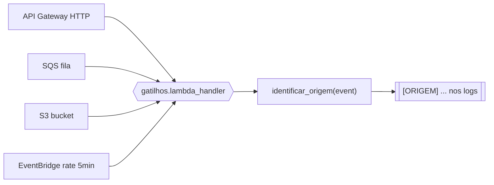

# U1-LAB01 — Lambda: alô mundo, gatilhos, ciclo de vida e comparativo de runtimes

Primeiro laboratório da disciplina. Lab de fundamentos que precede as demos de mensageria (fan-out, idempotência, DLQ). Em 5 partes, o Lambda vira função implantada, gatilho disparado e número medido.

## 1. Objetivos de aprendizagem (Bloom)

- **Reconhecer** os campos `Init Duration`, `Duration` e `Billed Duration` na linha `REPORT`.
- **Diferenciar** a forma do `event` conforme a fonte (API Gateway, SQS, S3, EventBridge).
- **Descrever** o ciclo de vida (Init → Invoke → Shutdown) e identificar reúso de container.
- **Identificar** as magnitudes de cold start por runtime e o efeito do SnapStart.

Pré-requisitos: [ferramental e credenciais](../00-comece-aqui/pre-requisitos.md). Base conceitual: fundamentos [1](../01-fundamentos/1-serverless-e-faas.md)–[4](../01-fundamentos/4-runtimes-e-snapstart.md).

## 2. Motivação

Cold start, custo e a penalidade da JVM viram folclore quando ficam só no slide. Este lab troca a crença pela medição: você implanta as mesmas funções em três runtimes e lê os números reais no CloudWatch. É por isso que a Parte 4 é o único lab multilíngue da disciplina — o comparativo **é** o conteúdo.

## 3. Estrutura

```
lab-u1-01/
├── fundamentos/   # Partes 1-3 (Python) — 1 stack
│   ├── template.yaml
│   ├── src/{alo,gatilhos,ciclo_vida}.py
│   └── tests/              # pytest (identificação de origem, handlers)
├── runtimes/        # Parte 4 (Python · Java · Go) — 1 stack
│   ├── template.yaml
│   ├── python/  go/  java/
│   └── medir.sh            # coleta os números de cold start
├── snapstart/       # Parte 5 (Java com/sem SnapStart) — 1 stack
└── scripts/                # disparar-gatilhos.sh, comparar-snapstart.sh
```

Cada parte é um stack SAM independente. Comandos via [`Makefile`](../../../Makefile) na raiz.

## 4. Topologia dos gatilhos (Parte 2)

Um único handler, quatro fontes:



O ponto a **identificar**: a decisão de qual fonte disparou não está na configuração do handler — está na forma do `event`, que a função inspeciona em tempo de execução.

## 5. Código anotado

O handler de gatilhos deduz a origem pela assinatura do envelope:

```python
def identificar_origem(event):
    if "requestContext" in event and "http" in event.get("requestContext", {}):
        return "API Gateway (HTTP)", ...
    if _tem_records_de(event, "aws:sqs"):
        return "SQS", ...
    if _tem_records_de(event, "aws:s3"):
        return "S3", ...
    if "detail-type" in event and "source" in event:
        return "EventBridge", ...
    return "desconhecida", ...
```

O ciclo de vida grava estado **fora** do handler (fase Init) e conta invocações:

```python
carregado_em = time.time()          # roda 1x por ambiente (Init)
invocacoes_neste_ambiente = 0

def lambda_handler(event, context):
    global invocacoes_neste_ambiente
    invocacoes_neste_ambiente += 1  # cresce nas partidas quentes
    ...
```

## 6. Rodar e observar

### Parte 1 — Alô mundo

```bash
make deploy-fundamentos
make invoke-alo
```

Saída real (1ª invocação, partida fria):

```
Alô, serverless! A função executou.
REPORT ... Duration: 2.43 ms  Billed Duration: 85 ms  Init Duration: 82.16 ms
```

Invoque de novo: o `Init Duration` some (partida quente). Note que o `Billed Duration` da fria (85 ms) ≈ Init + Duration — a Init **foi** faturada.

### Parte 2 — Gatilhos

```bash
make gatilhos
```

Saída real (as três fontes disparadas identificadas nos logs):

```
[ORIGEM] API Gateway (HTTP) — POST /disparar
[ORIGEM] SQS — lote com 1 mensagem(ns)
[ORIGEM] S3 — s3://.../teste-lab.txt
```

O EventBridge dispara sozinho a cada 5 min.

### Parte 3 — Ciclo de vida

```bash
make invoke-ciclo
```

Saída real (contador cresce, mesmo ambiente):

```
[HANDLER] PARTIDA FRIA — invocacoes_neste_ambiente=1
[HANDLER] PARTIDA QUENTE — invocacoes_neste_ambiente=2
[HANDLER] PARTIDA QUENTE — invocacoes_neste_ambiente=3
```

### Parte 4 — Comparativo de runtimes (só AWS real)

```bash
make deploy-runtimes
make medir        # N=5 amostras por runtime; salva resultado-AAAA-MM-DD.md
```

Tabela real (mediana):

| Runtime | Init min | Init mediana | Init p90 |
|---------|----------|--------------|----------|
| Go | 61 ms | 62 ms | 76 ms |
| Python | 61 ms | 83 ms | 94 ms |
| Java | 321 ms | 420 ms | 448 ms |

### Parte 5 — SnapStart (só AWS real)

```bash
make deploy-snapstart
make snapstart
```

Real: sem SnapStart `Init Duration ~1990 ms`; com SnapStart `Restore Duration ~916 ms` / `Billed Restore ~281 ms`. O log `[INIT]` some no caminho com SnapStart — a Init rodou uma vez, no publish.

## 7. Fluxo do ciclo de vida (Partes 1 e 3)

```
evento chega
   │
   ├─ existe ambiente quente? ── sim ──► [Invoke] handler ──► (fatura)
   │                                         ▲
   └─ não ─► [Init] cria ambiente + runtime + código fora do handler
             = PARTIDA FRIA (Init Duration)  │
                                             └► ambiente congela e espera ─► (reúso)
```

## 8. Pontos de atenção

| Sintoma | Causa | Correção |
|---------|-------|----------|
| "Toda invocação parece cold start" | Medir só a 1ª chamada | Cold start só na 1ª, após inatividade ou escala. Invoque em sequência. |
| SnapStart "não faz efeito" | Invocar `$LATEST` | Invoque o alias `u1lab01-snapstart-on:live`. |
| `Init Duration` ausente | Invocação quente | Esperado; `medir.sh` força cold start antes de cada medida. |
| Deploy falha: reserva concorrência < 10 | Conta AWS nova (teto 10) | O template **não** usa `ReservedConcurrentExecutions`. |
| Java build falha | JDK ≠ 21 | O `Makefile` aponta `JAVA_HOME` para o `openjdk@21`. |

## 9. Checklist de compreensão

- [ ] Sei dizer, na ordem, o que acontece entre o evento chegar e o ambiente voltar à espera — e onde começa o faturamento.
- [ ] Consigo diferenciar um evento SQS de um S3 olhando o `event`.
- [ ] Explico que boa prática o reúso de container habilita — e que bug ele permite.
- [ ] Sei por que a JVM penaliza no cold start e o que o SnapStart faz.
- [ ] Entendo por que o SnapStart só compensa com Init cara.

## 10. Limpeza

```bash
make clean    # remove os 3 stacks + artefatos locais
```

## 11. Referências

- *Serverless Architectures on AWS, 2nd ed* — Sbarski (Manning), Cap. 1.
- Documentação AWS — "Lambda execution environment lifecycle" e "AWS Lambda SnapStart".

---

⬅️ [Runtimes e SnapStart](../01-fundamentos/4-runtimes-e-snapstart.md) · 📑 [Índice](../index.md) · [Arquitetura ➡️](../03-arquitetura/arquitetura.md)
