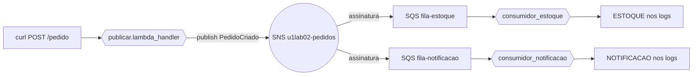

# U1-LAB02 — Fan-out com SNS + SQS

Segundo laboratório da disciplina. Sai dos fundamentos de uma função isolada (U1-LAB01) e monta a primeira **topologia de mensageria**: um evento, vários consumidores desacoplados.

## 1. Objetivos de aprendizagem

- **Descrever** o padrão fan-out: uma publicação, N entregas independentes.
- **Diferenciar** [SNS](../glossario.md#sns) (pub/sub, *push*) de [SQS](../glossario.md#sqs) (fila, *pull*) e explicar por que se combinam.
- **Identificar** o [duplo envelope](../glossario.md#fan-out) SQS→SNS e desembrulhá-lo no consumidor.
- **Explicar** por que uma fila por consumidor dá isolamento de falha.

Base conceitual: [Mensageria e fan-out](../01-fundamentos/5-mensageria-e-fanout.md). Pré-requisitos: [ferramental e credenciais](../00-comece-aqui/pre-requisitos.md).

## 2. Motivação

"Quando um pedido é criado, baixe o estoque e avise o cliente." A versão ingênua faz o produtor chamar os dois serviços — e paga em acoplamento: o produtor conhece cada consumidor, quebra se um cair, muda a cada consumidor novo. Este lab troca as chamadas diretas por uma **publicação**: o produtor anuncia o fato `PedidoCriado` e segue em frente. Quem reage se inscreve no tópico. Adicionar um terceiro consumidor não toca no produtor — só acrescenta uma fila e uma assinatura.

## 3. Estrutura

```
lab-u1-02/
├── template.yaml            # SNS + 2 filas SQS + assinaturas + 3 Lambdas
├── src/
│   ├── comum.py             # lógica pura: montar_evento, ler_pedido, extrair_evento
│   ├── publicar.py          # produtor: publica no SNS
│   ├── consumidor_estoque.py       # consumidor A
│   └── consumidor_notificacao.py   # consumidor B
├── tests/                   # pytest (duplo envelope + montagem de evento)
└── scripts/publicar-e-observar.sh
```

Um stack SAM. Comandos via [`Makefile`](../../../Makefile) na raiz.

## 4. Topologia



O ponto a **descrever**: entre o produtor e os consumidores não há nenhuma referência direta. O SNS é o ponto de desacoplamento; as filas dão o buffer e o isolamento.

## 5. Código anotado

O produtor publica **uma vez** e não sabe quem lê:

```python
def lambda_handler(event, context):
    pedido = ler_pedido(event)            # normaliza API GW / invocação direta
    evento = montar_evento(pedido)        # vira o fato PedidoCriado
    sns.publish(TopicArn=TOPICO_ARN, Message=json.dumps(evento), ...)
```

O consumidor desembrulha o **duplo envelope** — a pegadinha central:

```python
def extrair_evento(registro_sqs):
    envelope = json.loads(registro_sqs["body"])   # 1º: body do SQS = envelope SNS
    if envelope.get("Type") == "Notification":
        return json.loads(envelope["Message"])     # 2º: Message = evento de domínio
    return envelope                                # raw delivery: já é o evento
```

Os dois consumidores são o mesmo código-base (`src/`), handlers diferentes. Cada um itera `event["Records"]` da **sua** fila e reage ao mesmo `PedidoCriado`.

## 6. Rodar e observar

```bash
make deploy-fanout     # implanta o stack u1lab02-fanout
make fanout            # publica 1 pedido e observa os 2 consumidores
```

Saída real (uma publicação, dois consumidores reagindo **no mesmo instante**, cada um da sua fila):

```
== publicando 1 pedido (p-1783777208) no tópico ==
{"publicado": {"tipo": "PedidoCriado", "pedidoId": "p-1783777208", "valor": 250, ...}}

== [ESTOQUE] reagiu? ==
2026-07-11T13:40:09 [ESTOQUE] reservando itens do pedido p-1783777208 (valor=250, itens=2)
== [NOTIFICACAO] reagiu? ==
2026-07-11T13:40:09 [NOTIFICACAO] enviando confirmação do pedido p-1783777208 ao cliente (valor=250)
```

Mesmo `pedidoId`, mesmo segundo, dois handlers distintos. **Isso é o fan-out**: o produtor publicou uma vez; o SNS entregou duas.

## 7. Isolamento de falha

As filas são separadas de propósito. Se o `consumidor-notificacao` travar, as mensagens dele empilham **na fila de notificação** e são reprocessadas quando ele voltar — o `consumidor-estoque` não percebe, já seguiu na sua própria fila. Uma fila só, compartilhada, perderia esse isolamento.

## 8. Pontos de atenção

| Sintoma | Causa | Correção |
|---------|-------|----------|
| Mensagem "some": SNS publica, fila vazia | Falta a `AWS::SQS::QueuePolicy` autorizando `sns.amazonaws.com` | O template já inclui `PoliticaFilas` com `Condition` no ARN do tópico. |
| `KeyError: 'Message'` no consumidor | Assumir 1 nível de envelope | Entrega padrão do SNS embrulha 2x; use `extrair_evento` (dois `json.loads`). |
| Só um consumidor reage | Assinatura ou fila faltando | Cada consumidor precisa de **sua** fila + `AWS::SNS::Subscription`. |
| Mensagem processada duas vezes | SQS é *at-least-once* | Esperado; a defesa (idempotência) é o [U1-LAB03](u1-03.md). |
| Deploy falha: reserva concorrência < 10 | Conta AWS nova (teto 10) | O template não usa `ReservedConcurrentExecutions`. |

## 9. Checklist de compreensão

- [ ] Sei explicar por que publicar um fato desacopla mais que chamar um serviço.
- [ ] Diferencio o papel do SNS (fan-out) do papel da SQS (buffer + isolamento).
- [ ] Consigo desembrulhar, na mão, um evento SNS entregue via SQS.
- [ ] Explico o que uma fila por consumidor protege que uma fila compartilhada não protegeria.
- [ ] Sei por que "processado duas vezes" é esperado — e qual lab resolve isso.

## 10. Limpeza

```bash
make clean    # remove todos os stacks (inclui u1lab02-fanout) + artefatos locais
```

## 11. Referências

- *Serverless Architectures on AWS, 2nd ed* — Sbarski (Manning), Cap. 6 (mensageria).
- Documentação AWS — "Fanout to Amazon SQS queues" e "Amazon SNS message delivery".

---

⬅️ [Mensageria e fan-out](../01-fundamentos/5-mensageria-e-fanout.md) · 📑 [Índice](../index.md) · [Arquitetura ➡️](../03-arquitetura/arquitetura.md)
