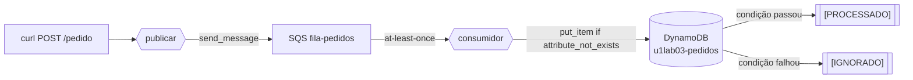

# U1-LAB03 — Idempotência com Lambda + DynamoDB

Terceiro laboratório. Fecha a lacuna que o fan-out (U1-LAB02) deixou explícita: se a SQS entrega *at-least-once*, como processar cada pedido **uma única vez**?

## 1. Objetivos de aprendizagem

- **Explicar** por que a entrega *at-least-once* da [SQS](../glossario.md#sqs) obriga o consumidor a ser idempotente.
- **Descrever** o padrão de *conditional write* no [DynamoDB](../glossario.md#dynamodb) como defesa contra duplicatas.
- **Diferenciar** a chave de idempotência (identidade de negócio) do `MessageId` da mensagem.
- **Identificar** o papel do TTL no armazém de deduplicação.

Base conceitual: [Idempotência e entrega at-least-once](../01-fundamentos/6-idempotencia-e-entrega.md). Pré-requisitos: [ferramental e credenciais](../00-comece-aqui/pre-requisitos.md).

## 2. Motivação

No U1-LAB02, o glossário já avisava: a SQS entrega *at-least-once*, então a mesma mensagem pode chegar duas vezes. Ali isso era uma nota de rodapé; aqui é o problema central. Se "processar `PedidoCriado`" cobra um cartão, a duplicata cobra de novo. Este lab constrói a defesa canônica — e a **prova**, enviando o mesmo pedido duas vezes e mostrando que o efeito aconteceu uma só.

## 3. Estrutura

```
lab-u1-03/
├── template.yaml            # SQS + DynamoDB (TTL) + 2 Lambdas
├── src/
│   ├── comum.py             # puro: chave_idempotencia, montar_item, eh_duplicado, extrair_evento
│   ├── publicar.py          # produtor: envia à SQS (aceita pedidoId, p/ reenviar igual)
│   └── consumidor.py        # consumidor idempotente: conditional write no DynamoDB
├── tests/                   # pytest (chave, item+TTL, reconhecimento de duplicata)
└── scripts/enviar-duplicado-e-observar.sh
```

Um stack SAM. Comandos via [`Makefile`](../../../Makefile) na raiz.

## 4. Topologia



O ponto a **descrever**: a decisão "processar ou ignorar" não está num `if` do código do consumidor — está no resultado atômico da gravação condicional no DynamoDB.

## 5. Código anotado

O consumidor tenta gravar sob condição; o efeito só ocorre no ramo que grava:

```python
try:
    tabela.put_item(
        Item=montar_item(evento, int(time.time())),
        ConditionExpression="attribute_not_exists(pedidoId)",
    )
    print(f"[PROCESSADO] pedido {chave} gravado (efeito aplicado)")   # 1ª vez
except ClientError as erro:
    if eh_duplicado(erro.response["Error"]["Code"]):
        print(f"[IGNORADO] pedido {chave} já processado")             # duplicata
    else:
        raise                                                          # erro real propaga
```

A chave é a identidade **de negócio**, estável entre entregas:

```python
def chave_idempotencia(evento):
    if not evento.get("pedidoId"):
        raise ValueError("evento sem 'pedidoId'")
    return str(evento["pedidoId"])
```

E o item carrega um `ttl` para expirar sozinho (`montar_item` recebe o `agora` por parâmetro — puro e testável).

## 6. Rodar e observar

```bash
make deploy-idem       # implanta o stack u1lab03-idempotencia
make idem              # envia o MESMO pedido 2x e prova a idempotência
```

Saída real (dois envios do mesmo `pedidoId`):

```
== enviando o pedido p-dup-1783778194 DUAS vezes (mesma identidade) ==
  envio 1: {"enviado": {..., "pedidoId": "p-dup-1783778194", ...}}
  envio 2: {"enviado": {..., "pedidoId": "p-dup-1783778194", ...}}

== o que o consumidor decidiu (logs) ==
2026-07-11T13:56:36 [PROCESSADO] pedido p-dup-1783778194 gravado (efeito aplicado)
2026-07-11T13:56:36 [IGNORADO]  pedido p-dup-1783778194 já processado (idempotência)

== quantos itens o DynamoDB guardou? ==
| pedido            | processadoEm | valor |
| p-dup-1783778194  | 1783778196   | 250   |
```

Dois envios, **um** `PROCESSADO` e **um** `IGNORADO`, e a tabela com **um único item**. O efeito aconteceu uma vez só.

## 7. Por que a atomicidade importa

Um `if tabela.get_item(...): return` seguido de `put_item` teria uma **janela de corrida**: duas entregas concorrentes leriam "não existe" antes de qualquer uma gravar, e ambas processariam. O *conditional write* elimina a janela — teste da condição e gravação são uma operação atômica. É por isso que a defesa vale sob concorrência, não só sob repetição em sequência.

## 8. Pontos de atenção

| Sintoma | Causa | Correção |
|---------|-------|----------|
| Duplicata processada mesmo assim | Deduplicar por `MessageId` da SQS | Use a chave de **negócio** (`pedidoId`); cada entrega tem `MessageId` diferente. |
| `AccessDenied` ao gravar | Falta permissão na tabela | O template usa `DynamoDBCrudPolicy` escopada à tabela. |
| Erro real engolido como "duplicata" | Tratar todo `ClientError` como ignorável | `eh_duplicado` só aceita `ConditionalCheckFailedException`; o resto propaga. |
| Tabela cresce sem parar | Sem expiração | Atributo `ttl` + `TimeToLiveSpecification` no template. |
| Deploy falha: reserva concorrência < 10 | Conta AWS nova (teto 10) | O template não usa `ReservedConcurrentExecutions`. |

## 9. Checklist de compreensão

- [ ] Explico por que *at-least-once* não é falha rara, e sim contrato da fila.
- [ ] Sei por que deduplicar pelo `MessageId` da SQS não funcionaria.
- [ ] Descrevo o *conditional write* e por que a atomicidade (não o "check-then-put") é o que o torna correto.
- [ ] Entendo o papel do TTL no armazém de deduplicação.
- [ ] Consigo apontar, no código, o único ponto onde o efeito de negócio é aplicado.

## 10. Limpeza

```bash
make clean    # remove todos os stacks (inclui u1lab03-idempotencia) + artefatos locais
```

## 11. Referências

- *Serverless Architectures on AWS, 2nd ed* — Sbarski (Manning), Cap. 6.
- Documentação AWS — "Conditional writes" (DynamoDB) e "Amazon SQS at-least-once delivery".

---

⬅️ [Idempotência e entrega](../01-fundamentos/6-idempotencia-e-entrega.md) · 📑 [Índice](../index.md) · [Arquitetura ➡️](../03-arquitetura/arquitetura.md)
