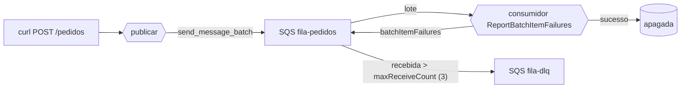

# U1-LAB04 — DLQ e resiliência com Lambda

Quarto e último laboratório da unidade. Fecha a trilha de mensageria: o U1-LAB03 tratou a mensagem que chega **duas vezes**; aqui, a que **nunca** processa.

## 1. Objetivos de aprendizagem

- **Explicar** o que é uma mensagem "veneno" e por que reprocessá-la não resolve.
- **Descrever** a *redrive policy* (`maxReceiveCount` → [DLQ](../glossario.md#dlq)) que a [SQS](../glossario.md#sqs) aplica sozinha.
- **Diferenciar** falhar o lote inteiro de reportar só os itens falhados (`ReportBatchItemFailures`).
- **Identificar** por que o *visibility timeout* precisa ser ≥ o timeout da função.

Base conceitual: [DLQ e resiliência](../01-fundamentos/7-dlq-e-resiliencia.md). Pré-requisitos: [ferramental e credenciais](../00-comece-aqui/pre-requisitos.md).

## 2. Motivação

Toda a unidade construiu confiança no fluxo feliz. Falta o dia ruim: um pedido com valor negativo, um JSON corrompido, um campo faltando. Sem defesa, o veneno vira loop infinito — a SQS reentrega, o consumidor falha, a mensagem volta. Este lab dá um **limite** (3 tentativas) e um **destino** (a DLQ), e prova que uma mensagem ruim no meio de um lote bom não arrasta as boas de volta.

## 3. Estrutura

```
lab-u1-04/
├── template.yaml            # fila + DLQ (redrive) + 2 Lambdas
├── src/
│   ├── comum.py             # puro: validar_pedido, montar_resposta_lote, ...
│   ├── publicar.py          # produtor: envia lote (bons + veneno)
│   └── consumidor.py        # ReportBatchItemFailures: devolve só os falhados
├── tests/                   # pytest (validação do veneno + falha parcial)
└── scripts/veneno-e-dlq.sh
```

Um stack SAM. Comandos via [`Makefile`](../../../Makefile) na raiz.

## 4. Topologia



O ponto a **descrever**: nenhum código move a mensagem para a DLQ. A SQS faz isso sozinha, pela *redrive policy*, quando a contagem de recebimentos passa de `maxReceiveCount`.

## 5. Código anotado

O consumidor não deixa uma falha derrubar o lote — coleta os falhados e devolve só eles:

```python
for registro in event["Records"]:
    try:
        evento = validar_pedido(extrair_evento(registro))
        print(f"[OK] pedido {evento['pedidoId']} processado")
    except Exception as erro:
        falhas.append(registro["messageId"])          # só este volta
        print(f"[FALHA] tentativa {tentativa} — ...")
return montar_resposta_lote(falhas)   # {"batchItemFailures": [...]}
```

O que é "veneno" é uma decisão pura e testável:

```python
def validar_pedido(evento):
    if not evento.get("pedidoId"):
        raise PedidoInvalido("sem 'pedidoId'")
    if not isinstance(evento.get("valor"), (int, float)) or evento["valor"] <= 0:
        raise PedidoInvalido(f"valor inválido: {evento.get('valor')!r}")
```

## 6. Rodar e observar

```bash
make deploy-dlq        # implanta o stack u1lab04-dlq
make dlq               # envia lote (2 bons + 1 veneno) e observa a DLQ
```

O script explica o objetivo antes de cada etapa; a prova aparece nas seções finais (lote com `bom-a`, `veneno` de valor -1, `bom-b`):

```
▶ O que o consumidor fez (bons uma vez, veneno tentado 1→2→3)
14:18:28 [OK]    pedido bom-b-1783779507 processado (valor=200)
14:18:28 [FALHA] tentativa 1 — pedido veneno-1783779507: valor inválido: -1
14:18:28 [OK]    pedido bom-a-1783779507 processado (valor=100)
14:18:38 [FALHA] tentativa 2 — pedido veneno-1783779507: valor inválido: -1
14:18:48 [FALHA] tentativa 3 — pedido veneno-1783779507: valor inválido: -1

▶ Conteúdo do veneno na DLQ
{"tipo": "PedidoCriado", "pedidoId": "veneno-1783779507", "valor": -1, "itens": []}
```

Leitura: os dois bons foram processados **uma vez** (14:18:28) e apagados — nunca reaparecem. O veneno foi tentado **três vezes**, com ~10 s entre elas (o *visibility timeout*), e então movido para a DLQ, de onde o script leu o corpo. As boas não voltaram junto com a ruim: é a falha parcial funcionando.

> Nota: a métrica `ApproximateNumberOfMessages` da DLQ é eventualmente consistente e pode mostrar `0` no instante exato da 3ª falha; o `receive-message` logo em seguida traz a mensagem — a prova definitiva de que ela chegou lá.

> **`make dlq` não para aqui.** O script continua para uma Parte 2 (redrive) não mostrada acima — ver seção 6.1 logo adiante.

### 6.1 Parte 2 — Redrive: devolver o veneno da DLQ ao fluxo

Depois de provar que o veneno caiu na DLQ, o script demonstra a ação que um operador faria em produção: devolver a mensagem da DLQ para a fila de origem (`start-message-move-task`, a API nativa de redrive da SQS). No LocalStack Community esse redrive nativo é instável, então o script drena a DLQ com `receive-message` e reenvia cada mensagem à fila de origem com `send-message` — efeito equivalente.

Saída real, verificada via `LOCALSTACK=1 make dlq` (continuação do mesmo lote acima):

```
▶ Iniciando o redrive
  [LocalStack] redrive degradado: receive-message na DLQ + send-message p/ origem
  1 mensagem(ns) redrivada(s) da DLQ para a fila de origem

▶ O consumidor tentou o veneno outra vez?
14:19:22 [FALHA] tentativa 1 — pedido veneno-1783779507: valor inválido: -1
14:19:32 [FALHA] tentativa 2 — pedido veneno-1783779507: valor inválido: -1
14:19:43 [FALHA] tentativa 3 — pedido veneno-1783779507: valor inválido: -1

▶ A DLQ recebeu o veneno de volta?
  mensagens na DLQ: 1
```

Leitura: redrive **não corrige a causa** — só devolve a mensagem ao fluxo. Como `valor=-1` continua inválido, o consumidor falha as mesmas três tentativas e o veneno volta para a DLQ, exatamente como antes. Em produção, o operador corrige a causa raiz (deploy do fix ou dado corrigido) **antes** de redrivar — só então o redrive termina em sucesso, com a mensagem processada e removida da fila de origem.

## 7. Por que o timeout de visibilidade importa

As tentativas caem a cada ~10 s porque esse é o *visibility timeout* da fila. Ele é **maior** que o timeout da função (5 s) de propósito: se fosse menor, a mensagem reapareceria e seria entregue a uma segunda invocação enquanto a primeira ainda roda — processamento concorrente da mesma mensagem. A regra prática: *visibility timeout ≥ timeout da função* (a AWS recomenda 6×).

## 8. Pontos de atenção

| Sintoma | Causa | Correção |
|---------|-------|----------|
| Fila trava girando no mesmo erro | Sem `maxReceiveCount`/DLQ | *Redrive policy* com DLQ dá limite e destino ao veneno. |
| Pedidos bons reprocessados a cada retry | Falhar o lote inteiro | `ReportBatchItemFailures` + devolver só os `itemIdentifier` falhados. |
| Mensagem processada em duplicidade sob carga | Visibility < timeout da função | Deixe o *visibility timeout* ≥ timeout da função (ideal 6×). |
| DLQ "vazia" logo após a 3ª falha | Métrica eventualmente consistente | Confirme com `receive-message`, não só pelo contador. |
| Veneno nunca chega à DLQ | `maxReceiveCount` alto demais | Ajuste ao equilíbrio retry × travamento (exercício 14). |

## 9. Checklist de compreensão

- [ ] Explico por que reprocessar um veneno não adianta e por isso ele precisa de destino.
- [ ] Descrevo como a SQS decide, sozinha, mover a mensagem para a DLQ.
- [ ] Diferencio falhar o lote inteiro de reportar só os itens falhados — e quando isso mais importa.
- [ ] Sei por que o *visibility timeout* precisa ser ≥ o timeout da função.
- [ ] Consigo apontar, no log, as três tentativas antes da DLQ.

## 10. Limpeza

```bash
make clean    # remove todos os stacks (inclui u1lab04-dlq) + artefatos locais
```

## 11. Referências

- *Serverless Architectures on AWS, 2nd ed* — Sbarski (Manning), Cap. 6.
- Documentação AWS — "Amazon SQS dead-letter queues" e "Reporting batch item failures" (Lambda).

---

⬅️ [DLQ e resiliência](../01-fundamentos/7-dlq-e-resiliencia.md) · 📑 [Índice](../index.md) · [Arquitetura ➡️](../03-arquitetura/arquitetura.md)
