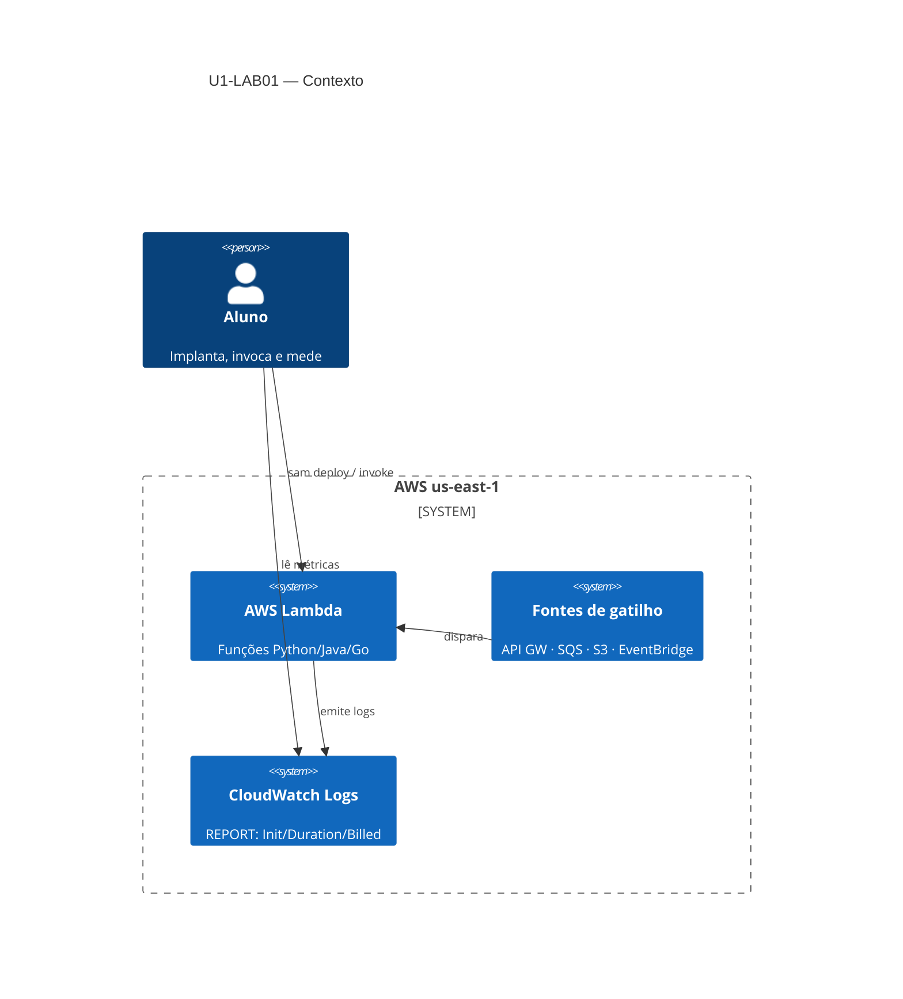
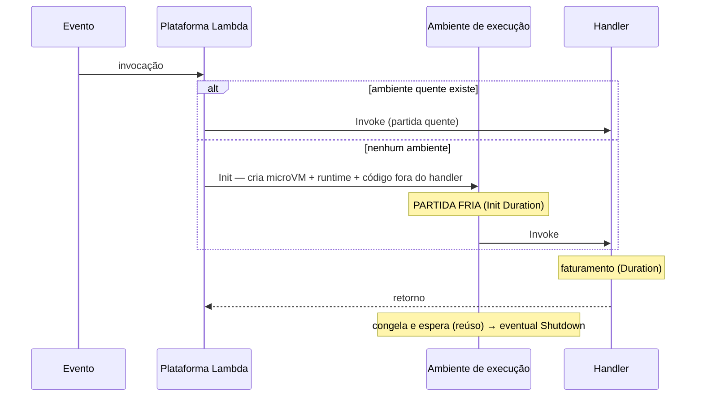
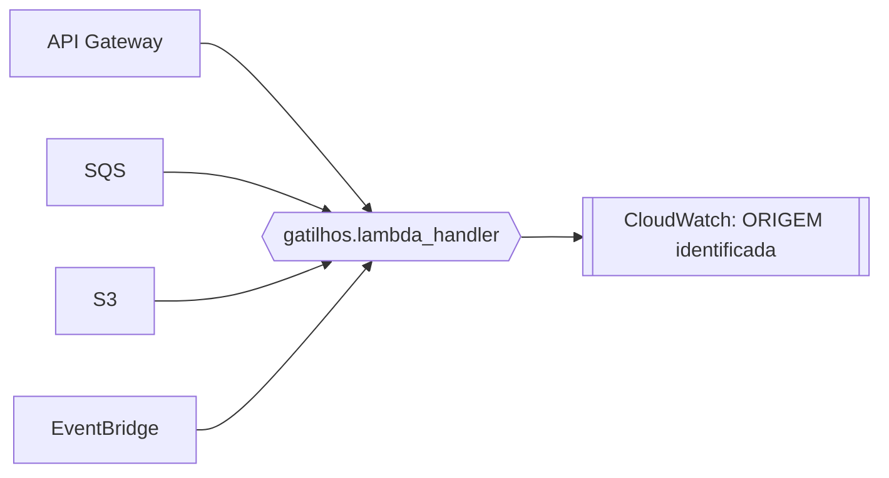

# Arquitetura — Unidade 1

Visão de arquitetura dos recursos exercitados no U1-LAB01.

## Contexto (C4 nível 1)

## Ciclo de vida (sequência)

## Topologia de gatilhos (Parte 2)

## Componentes por parte

| Recurso | P1 alô | P2 gatilhos | P3 ciclo | P4 runtimes | P5 SnapStart |
|---------|:------:|:-----------:|:--------:|:-----------:|:------------:|
| Lambda Python | ✓ | ✓ | ✓ | ✓ | — |
| Lambda Java 21 | — | — | — | ✓ | ✓ |
| Lambda Go | — | — | — | ✓ | — |
| API Gateway (HTTP) | — | ✓ | — | — | — |
| SQS | — | ✓ | — | — | — |
| S3 | — | ✓ | — | — | — |
| EventBridge | — | ✓ | — | — | — |
| Alias + versão (SnapStart) | — | — | — | — | ✓ |

## Decisões de arquitetura registradas

- **3 stacks separados** — cada parte é implantada e removida isoladamente; falha em uma não derruba as outras.
- **Sem `ReservedConcurrentExecutions`** — contas AWS novas têm teto de concorrência 10; reservar sob o piso é rejeitado. O reúso de container é observável sem reservar.
- **arm64 + 512 MB uniformes na Parte 4** — comparação justa entre runtimes; só o runtime varia.
- **Init pesada simulada na Parte 5** — sem custo real de inicialização, o SnapStart não teria o que amortizar e a demonstração falharia.

---

⬅️ [Demo U1-LAB01](../02-demos/u1-01.md) · 📑 [Índice](../index.md) · [Exercícios ➡️](../exercicios.md)
