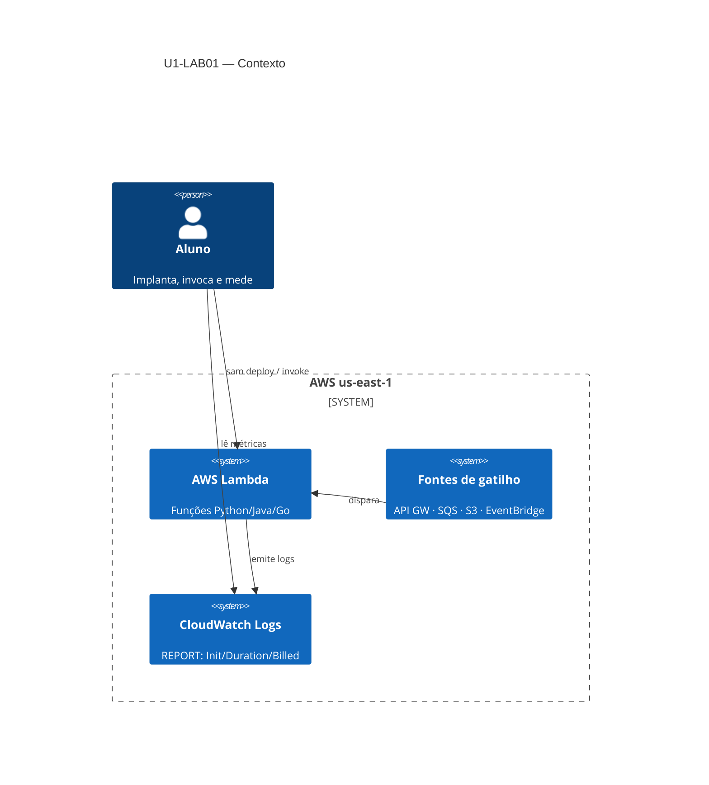
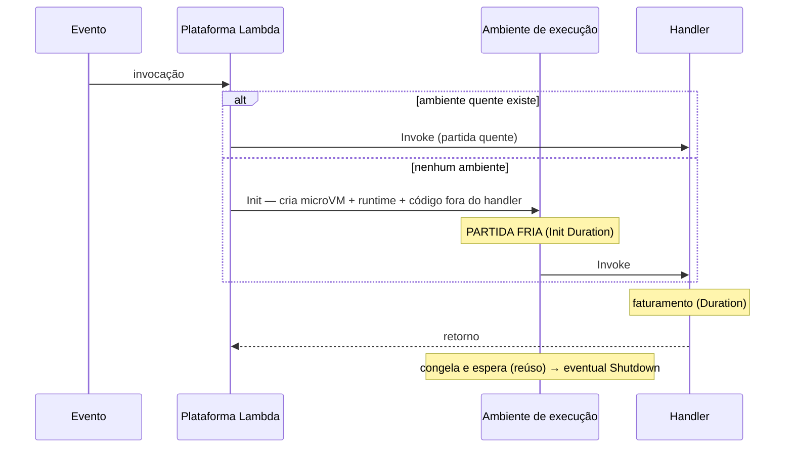
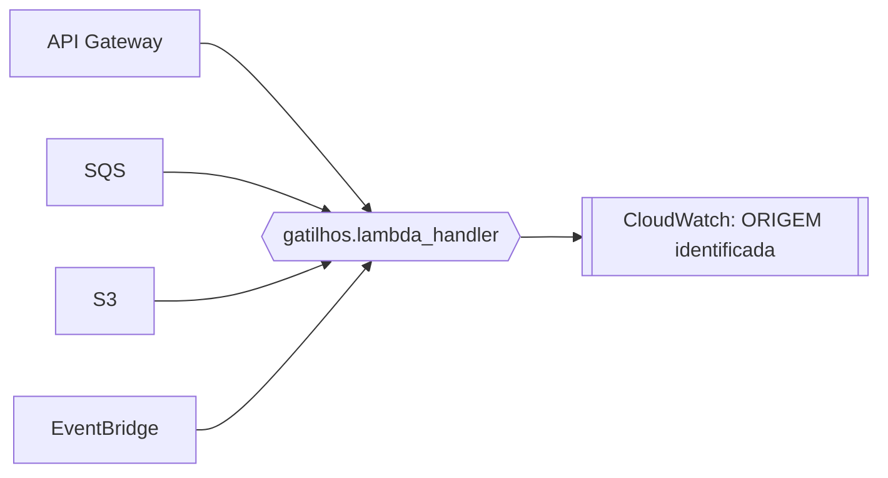
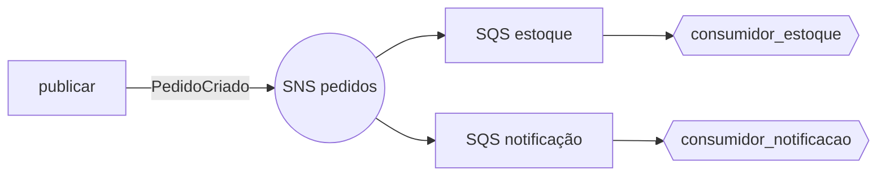
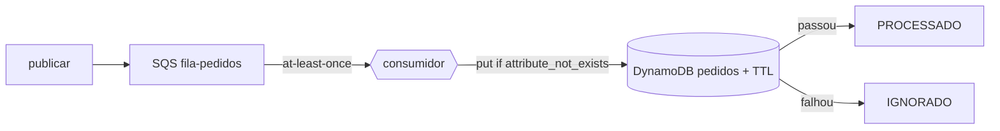
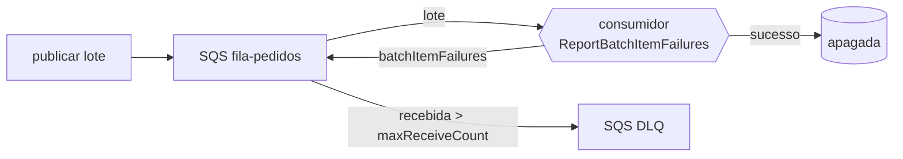

# Arquitetura — Unidade 1

Visão de arquitetura dos recursos exercitados nos laboratórios da unidade (U1-LAB01 e U1-LAB02).

## Contexto (C4 nível 1)

## Ciclo de vida (sequência)

## Topologia de gatilhos (Parte 2)

## Topologia de fan-out (U1-LAB02)

Um produtor publica; o SNS espalha; cada consumidor tem sua própria fila.

Entre produtor e consumidores não há referência direta — o tópico desacopla, as filas isolam falhas.

## Topologia de idempotência (U1-LAB03)

A duplicata da fila é absorvida por uma gravação condicional no DynamoDB.

A decisão "processar ou ignorar" é o resultado atômico da gravação, não um `if` no código.

## Topologia de DLQ (U1-LAB04)

Mensagem boa é apagada; veneno é reentregue até o limite e movido à DLQ.

A SQS move o veneno para a DLQ sozinha, pela *redrive policy* — sem código nosso.

## Componentes por parte

| Recurso | P1 alô | P2 gatilhos | P3 ciclo | P4 runtimes | P5 SnapStart |
|---------|:------:|:-----------:|:--------:|:-----------:|:------------:|
| Lambda Python | ✓ | ✓ | ✓ | ✓ | — |
| Lambda Java 21 | — | — | — | ✓ | ✓ |
| Lambda Go | — | — | — | ✓ | — |
| API Gateway (HTTP) | — | ✓ | — | — | — |
| SQS | — | ✓ | — | — | — |
| S3 | — | ✓ | — | — | — |
| EventBridge | — | ✓ | — | — | — |
| Alias + versão (SnapStart) | — | — | — | — | ✓ |

## Decisões de arquitetura registradas

- **3 stacks separados** — cada parte é implantada e removida isoladamente; falha em uma não derruba as outras.
- **Sem `ReservedConcurrentExecutions`** — contas AWS novas têm teto de concorrência 10; reservar sob o piso é rejeitado. O reúso de container é observável sem reservar.
- **arm64 + 512 MB uniformes na Parte 4** — comparação justa entre runtimes; só o runtime varia.
- **Init pesada simulada na Parte 5** — sem custo real de inicialização, o SnapStart não teria o que amortizar e a demonstração falharia.
- **Uma fila SQS por consumidor no fan-out (U1-LAB02)** — não uma fila compartilhada. Filas separadas isolam falha: um consumidor travado empilha na sua própria fila sem afetar os demais.
- **Entrega padrão SNS→SQS (não *raw*) no U1-LAB02** — o duplo envelope é conteúdo pedagógico; desligar o *raw delivery* força o aluno a desembrulhar os dois níveis.
- **DynamoDB on-demand + TTL no U1-LAB03** — `PAY_PER_REQUEST` evita provisionar/limpar capacidade; o TTL expira os registros de deduplicação sem job de limpeza.
- **Idempotência por *conditional write*, não *check-then-put* (U1-LAB03)** — a atomicidade da gravação condicional fecha a janela de corrida que o "ler depois gravar" abriria sob concorrência.
- **DLQ com `maxReceiveCount=3` e `VisibilityTimeout` (10s) > timeout da função (5s) no U1-LAB04** — a visibilidade acima do timeout evita entrega concorrente da mesma mensagem; o limite baixo faz o veneno chegar à DLQ rápido para a demo.
- **`ReportBatchItemFailures` em vez de falhar o lote todo (U1-LAB04)** — devolver só os `itemIdentifier` falhados evita reprocessar as mensagens boas do mesmo lote.

---

⬅️ [Demo U1-LAB01](../02-demos/u1-01.md) · 📑 [Índice](../index.md) · [Exercícios ➡️](../exercicios.md)
