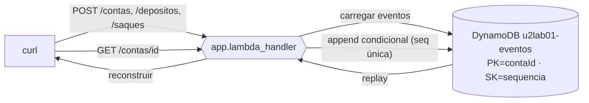

# U2-LAB01 — Event store append-only

Primeiro laboratório da Unidade 2. Abandona o estado mutável (CRUD) e grava a conta como uma sequência imutável de eventos num event store DynamoDB.

## 1. Objetivos de aprendizagem (Bloom)

- **Descrever** Event Sourcing: gravar fatos, não o resultado, e reconstruir por replay.
- **Explicar** por que o estado nunca é sobrescrito e como o append-only preserva a história.
- **Identificar** o fluxo de comando: carregar → reconstruir → decidir → anexar.
- **Diferenciar** concorrência otimística (conditional write) de trava pessimista.

Base conceitual: [Event Sourcing](../01-fundamentos/1-event-sourcing.md). Pré-requisitos e ferramental: [Unidade 1 › comece aqui](../../unidade-1/00-comece-aqui/pre-requisitos.md) (mesmo stack: Python, SAM, AWS).

## 2. Motivação

`UPDATE contas SET saldo = 120` apaga como a conta chegou lá. Este lab guarda cada fato — `ContaCriada`, `DepositoRealizado`, `SaqueRealizado` — e deriva o saldo aplicando-os em ordem. O resultado é uma trilha de auditoria completa de graça e a capacidade de reconstruir qualquer estado passado. É o mesmo domínio da disciplina reativa (Java + Postgres); aqui, Python + DynamoDB.

## 3. Estrutura

```
lab-u2-01/
├── template.yaml           # DynamoDB (PK=contaId, SK=sequencia) + Lambda (4 rotas)
├── src/
│   ├── dominio.py          # puro: ContaBancaria.aplicar, reconstruir (replay)
│   ├── comandos.py         # puro: criar/depositar/sacar — as invariantes
│   └── app.py              # handler HTTP: carregar→reconstruir→decidir→anexar
├── tests/                  # pytest (replay determinístico + invariantes)
└── scripts/conta-e-replay.sh
```

Um stack SAM. Comandos via [`Makefile`](../../../Makefile) na raiz.

## 4. Topologia



O ponto a **identificar**: não há coluna `saldo`. A tabela guarda só eventos; o saldo é sempre recalculado.

## 5. Código anotado

O coração é puro — estado + evento → novo estado:

```python
def aplicar(self, evento):
    tipo = evento["tipo"]
    if tipo == "ContaCriada":       return replace(self, titular=evento["titular"])
    if tipo == "DepositoRealizado": return replace(self, saldo=self.saldo + _dec(evento["valor"]))
    if tipo == "SaqueRealizado":    return replace(self, saldo=self.saldo - _dec(evento["valor"]))
```

O comando decide sobre o estado reconstruído; a invariante recusa o saque a descoberto:

```python
def sacar(conta, valor):
    _exigir_positivo(valor)
    if conta.saldo < valor:
        raise SaldoInsuficiente(f"saldo insuficiente: {conta.saldo} < {valor}")
    return {"tipo": "SaqueRealizado", "contaId": conta.contaId, "valor": valor}
```

E a gravação é append-only com concorrência otimística:

```python
tabela.put_item(
    Item={**evento, "sequencia": sequencia, ...},
    ConditionExpression="attribute_not_exists(contaId) AND attribute_not_exists(sequencia)",
)
```

## 6. Rodar e observar

```bash
make deploy-eventstore     # implanta o stack u2lab01-eventstore
make eventstore            # cria conta, deposita, saca, faz replay e testa conflito
```

Saída real:

```
== depositar 100, depositar 50, sacar 30 ==
{"contaId": "4ba5...", "saldo": 100}
{"contaId": "4ba5...", "saldo": 150}
{"contaId": "4ba5...", "saldo": 120}

== estado reconstruído por replay (esperado: saldo 120, 4 eventos) ==
{"contaId": "4ba5...", "titular": "Maria", "saldo": 120, "eventos": 4}

== saque a descoberto (esperado: 422 saldo insuficiente) ==
  HTTP 422

== log append-only no DynamoDB (sequência de fatos) ==
| seq | tipo              |
| 1   | ContaCriada       |
| 2   | DepositoRealizado |
| 3   | DepositoRealizado |
| 4   | SaqueRealizado    |

== prova do guard: regravar a sequência 1 direto no DynamoDB (deve falhar) ==
  ✓ rejeitado: ConditionalCheckFailedException — a sequência 1 é imutável

== concorrência otimística: 5 depósitos de 10 em paralelo ==
  req1: 200   req2: 200   req3: 200   req4: 200   req5: 409
== estado final (append-only: nenhum update perdido) ==
{"contaId": "...", "titular": "Maria", "saldo": 160, "eventos": 8}
```

Leitura: o saldo **nunca** foi gravado — cada resposta é um replay. O log cresce append-only. O saque a descoberto é recusado pela invariante (422). Regravar uma sequência existente é rejeitado pelo DynamoDB (o guard determinístico). E na corrida, quatro depósitos gravaram e um perdeu a sequência (409) — sem *lost update*: 8 eventos, saldo 160 = 120 + 40.

## 7. Por que o conflito vira 409

Cinco requisições concorrentes leem o mesmo estado e miram a mesma próxima sequência. A chave `(contaId, sequencia)` com `attribute_not_exists` deixa **uma** gravar; as demais recebem `ConditionalCheckFailedException`, que o handler traduz em HTTP 409. O cliente que levou 409 deve recarregar e repetir — o custo da concorrência otimística, pago só quando há colisão de fato.

## 8. Pontos de atenção

| Sintoma | Causa | Correção |
|---------|-------|----------|
| Saldo "sumiu" após deploy | Esperar uma coluna de estado | Não existe; o saldo é sempre replay dos eventos. |
| `0.1 + 0.2 = 0.30000000000004` | Dinheiro em float | O domínio usa `Decimal`; o teste garante `0.3` exato. |
| Dois comandos, um se perde | Achar que o último escreve por cima | A sequência única rejeita o segundo (409); ele deve repetir. |
| Replay quebra com "tipo desconhecido" | Evento gravado fora do handler | `aplicar` só conhece os 3 tipos; grave sempre pela API. |
| Deploy falha: reserva concorrência < 10 | Conta AWS nova (teto 10) | O template não usa `ReservedConcurrentExecutions`. |

## 9. Checklist de compreensão

- [ ] Explico por que gravar eventos preserva história que o CRUD apaga.
- [ ] Reconstruo, na mão, o saldo a partir de uma lista de eventos.
- [ ] Descrevo o fluxo carregar → reconstruir → decidir → anexar.
- [ ] Sei por que a sequência única dá concorrência otimística e o que o cliente faz no 409.
- [ ] Entendo por que o estado nunca é sobrescrito na tabela.

## 10. Limpeza

```bash
make clean    # remove todos os stacks (inclui u2lab01-eventstore) + artefatos locais
```

## 11. Referências

- *Implementing Domain-Driven Design* — Vernon, cap. sobre Event Sourcing.
- Documentação AWS — "DynamoDB condition expressions" e "Optimistic locking".

---

⬅️ [Event Sourcing](../01-fundamentos/1-event-sourcing.md) · 📑 [Índice](../index.md) · [Arquitetura ➡️](../03-arquitetura/arquitetura.md)
