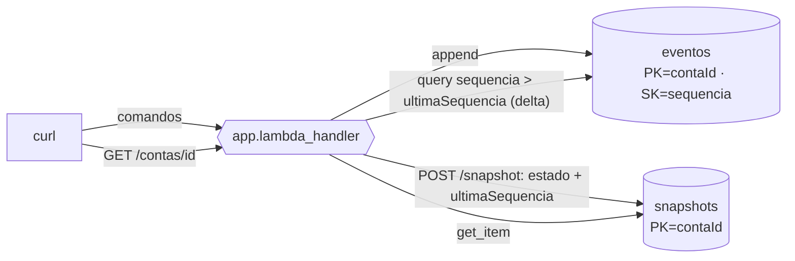

# U2-LAB02 — Replay e snapshots

Segundo laboratório da Unidade 2. Parte do event store do U2-LAB01 e ataca o custo do replay: reprocessar toda a história a cada consulta não escala. A resposta é o snapshot.

## 1. Objetivos de aprendizagem

- **Descrever** o replay como um *fold* puro, determinístico e idempotente.
- **Explicar** por que o custo do replay cresce com a idade do agregado.
- **Descrever** o snapshot: materializar o estado numa sequência e reprocessar só o delta.
- **Identificar** a invariante: snapshot + delta ≡ replay completo.

Base conceitual: [Replay e snapshots](../01-fundamentos/2-replay-e-snapshots.md). Ponto de partida: [U2-LAB01](u2-01.md).

## 2. Motivação

Uma conta com dezenas de milhares de eventos releria todos a cada consulta. O snapshot guarda o estado já calculado num ponto e deixa a leitura reprocessar só o que veio depois. Este lab prova as duas coisas ao mesmo tempo: que a consulta via snapshot lê **menos** eventos e que chega ao **mesmo** saldo do replay completo.

## 3. Estrutura

```
lab-u2-02/
├── template.yaml           # event store + tabela de snapshots + Lambda (6 rotas)
├── src/
│   ├── dominio.py          # + reconstruir_a_partir_de, (de)serialização de snapshot
│   ├── comandos.py         # invariantes (herdadas do U2-LAB01)
│   └── app.py              # snapshot: gravar + consulta via snapshot/delta
├── tests/                  # pytest (snapshot+delta ≡ replay completo)
└── scripts/snapshot-e-delta.sh
```

Um stack SAM. Comandos via [`Makefile`](../../../Makefile) na raiz.

## 4. Topologia



O ponto a **identificar**: a consulta via snapshot toca as duas tabelas — lê o estado-base no `snapshots` e só o delta no `eventos`.

## 5. Código anotado

Replay generalizado — dobra o delta sobre um estado-base qualquer:

```python
def reconstruir_a_partir_de(estado_base, eventos):
    estado = estado_base
    for evento in eventos:
        estado = estado.aplicar(evento)
    return estado
```

A consulta escolhe o caminho: snapshot + delta, ou replay completo se não há snapshot:

```python
snap = tabela_snapshots.get_item(Key={"contaId": contaId}).get("Item")
if snap:
    base = snapshot_para_estado(contaId, snap["estado"])
    delta = _eventos(contaId, apos_sequencia=int(snap["ultimaSequencia"]))
    return reconstruir_a_partir_de(base, delta), {...}
```

## 6. Rodar e observar

```bash
make deploy-snapshots      # implanta o stack u2lab02-snapshots
make snapshots             # acumula eventos, tira snapshot, reprocessa só o delta
```

O script explica o objetivo antes de cada etapa; a prova aparece nas seções seguintes:

```
▶ Consulta ANTES do snapshot (reprocessa todos os eventos)
{"saldo": 600, "viaSnapshot": false, "eventosReprocessados": 7}

▶ Tirando snapshot do estado atual
{"snapshotSequencia": 7, "saldo": 600}

▶ Consulta via snapshot (reprocessa só o delta)
{"saldo": 800, "viaSnapshot": true, "snapshotSequencia": 7, "eventosReprocessados": 2}

▶ Consulta por replay completo (para comparar o saldo)
{"saldo": 800, "viaSnapshot": false, "eventosReprocessados": 9}

▶ Conferência: os saldos batem?
  ✓ saldos idênticos — snapshot correto, lendo menos eventos
```

Leitura: antes do snapshot, a consulta reprocessa 7 eventos. Depois do snapshot na sequência 7 e mais 2 depósitos, a consulta via snapshot reprocessa **só 2** (o delta) — enquanto o replay completo relê os **9**. Os dois chegam a `800`: o snapshot acelera sem mudar a verdade.

### 6.1 Pegadinha ao vivo — por que o append PRECISA de `ConditionExpression`

Script separado, não citado no roteiro do `make snapshots` acima mas exigido pelo roteiro de gravação do U2V8 ("pegadinha ao vivo").

```bash
LOCALSTACK=1 make pegadinha
```

O script explica o objetivo antes de cada etapa; saída real, verificada via LocalStack:

```
▶ Criando conta + 2 depósitos de 100 (eventos seq 1, 2, 3)
  contaId=fc9c2b19-...

▶ Saldo por replay completo (esperado: 200)
{"contaId": "fc9c2b19-...", "titular": "Maria", "saldo": 200, "eventosReprocessados": 3}

▶ PEGADINHA: sobrescrever o evento seq 2 SEM ConditionExpression
  trocando o depósito de 100 por 999999 — o DynamoDB aceita como UPDATE:
  gravação aceita silenciosamente — o evento histórico foi substituído.

▶ Saldo por replay completo agora (corrompido)
{"contaId": "fc9c2b19-...", "titular": "Maria", "saldo": 1000099, "eventosReprocessados": 3}
  a história mudou: sem proteção, o append-only foi violado.

▶ A proteção: repetir a escrita COM a condição do lab
  ✓ ConditionalCheckFailedException — o DynamoDB recusou sobrescrever.
```

Leitura: um `put_item` sem `ConditionExpression` sobre uma chave (`contaId`+`sequencia`) que já existe vira um *upsert* silencioso — o saldo salta de 200 para 1.000.099 porque o evento histórico foi trocado, não um novo evento anexado. Repetir a mesma escrita com `attribute_not_exists(contaId) AND attribute_not_exists(sequencia)` faz o DynamoDB recusar — é exatamente essa condição que o `_append` do lab usa sempre, e é o que garante o append-only.

## 7. Snapshot é cache, não fonte da verdade

O event store continua sendo a verdade. O snapshot é derivado: pode ser apagado e refeito reprocessando os eventos. Por isso a gravação do snapshot é um `put_item` que sobrescreve — não há concorrência otimística aqui, ao contrário do append de eventos. Se o snapshot sumir, a consulta cai no replay completo (o `switchIfEmpty` do código) e continua correta.

## 8. Pontos de atenção

| Sintoma | Causa | Correção |
|---------|-------|----------|
| Saldo via snapshot ≠ replay completo | Delta pego errado (inclui/exclui a sequência do snapshot) | O delta é `sequencia > ultimaSequencia` (estritamente maior). |
| Consulta lenta mesmo com snapshot | Snapshot velho, delta enorme | Tire snapshots com mais frequência (a cada N eventos). |
| Snapshot "trava" gravação concorrente | Tratar snapshot como evento | Snapshot é cache: `put_item` sobrescreve, sem conditional write. |
| Estado errado após apagar snapshot | Achar que o snapshot é a verdade | Apagar o snapshot é seguro; a consulta cai no replay completo. |
| Dinheiro impreciso no snapshot | Serializar saldo como float | O estado guarda `Decimal`; o round-trip preserva o valor exato. |

## 9. Checklist de compreensão

- [ ] Explico por que o replay é idempotente e por que seu custo cresce com a história.
- [ ] Descrevo os três passos da consulta via snapshot (carregar, delta, dobrar).
- [ ] Sei por que snapshot + delta tem que bater com o replay completo.
- [ ] Entendo por que o snapshot é cache descartável, não fonte da verdade.
- [ ] Sei o que acontece com a consulta se o snapshot for apagado.

## 10. Limpeza

```bash
make clean    # remove todos os stacks (inclui u2lab02-snapshots) + artefatos locais
```

## 11. Referências

- *Versioning in an Event Sourced System* — Young (sobre snapshots e evolução).
- Documentação AWS — "DynamoDB Query" (KeyConditionExpression com range).

---

⬅️ [Replay e snapshots](../01-fundamentos/2-replay-e-snapshots.md) · 📑 [Índice](../index.md) · [Arquitetura ➡️](../03-arquitetura/arquitetura.md)
