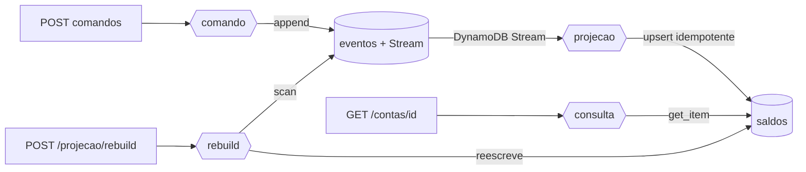

# U2-LAB03 — CQRS e projeção com DynamoDB Streams

Terceiro e último laboratório da Unidade 2. Separa leitura de escrita: a escrita grava eventos; um DynamoDB Stream alimenta uma projeção; a consulta lê só a projeção. É o padrão CQRS ponta a ponta em serverless.

## 1. Objetivos de aprendizagem

- **Descrever** o CQRS: modelos separados de escrita (comando) e leitura (consulta).
- **Explicar** a projeção via [DynamoDB Streams](../glossario.md#dynamodb-streams) e a [consistência eventual](../glossario.md#consistencia-eventual) resultante.
- **Identificar** por que a projeção precisa ser idempotente.
- **Descrever** o [rebuild](../glossario.md#rebuild) e a [transferência atômica](../glossario.md#transacao).

Base conceitual: [CQRS e projeção](../01-fundamentos/3-cqrs-e-projecao.md). Ponto de partida: [U2-LAB01](u2-01.md) e [U2-LAB02](u2-02.md).

## 2. Motivação

Consultar por replay não escala para leitura pesada. O CQRS resolve com dois modelos: a escrita continua sendo o event store; a leitura ganha uma projeção pronta, atualizada de forma assíncrona pelo stream. O preço é a consistência eventual — e este lab a mostra acontecendo, em segundos, além de provar a projeção idempotente, o rebuild e a transferência atômica.

## 3. Estrutura

```
lab-u2-03/
├── template.yaml           # eventos(+Stream) + saldos + 4 Lambdas
├── src/
│   ├── dominio.py          # ContaBancaria (puro)
│   ├── comandos.py         # invariantes (puro)
│   ├── projetar.py         # projeção incremental idempotente (puro)
│   ├── comando.py          # ESCRITA: grava eventos + transferência atômica
│   ├── projecao.py         # gatilho do Stream → tabela saldos
│   ├── consulta.py         # LEITURA: lê só a projeção
│   └── rebuild.py          # reprocessa o store → reescreve a projeção
├── tests/                  # pytest (projeção incremental + idempotência)
└── scripts/cqrs-projecao.sh
```

Um stack SAM, quatro funções. Comandos via [`Makefile`](../../../Makefile) na raiz.

## 4. Topologia



O ponto a **descrever**: as setas de escrita e de leitura nunca se cruzam. `comando` só grava em `eventos`; `consulta` só lê `saldos`. O stream é a ponte assíncrona.

## 5. Código anotado

O lado de leitura lê a projeção pronta — sem replay, sem eventos:

```python
# consulta.py — a regra de ouro do CQRS
linha = saldos.get_item(Key={"contaId": contaId}).get("Item")
if not linha:
    return _resp(404, {"erro": "conta ainda não projetada (consistência eventual)"})
```

A projeção é idempotente pela sequência (o stream entrega *at-least-once*):

```python
# projetar.py
if linha_atual is not None and seq <= int(linha_atual["ultimaSequencia"]):
    return linha_atual   # já projetado — não reaplica
```

E a transferência grava dois eventos, em dois agregados, atomicamente:

```python
# comando.py
cliente.transact_write_items(TransactItems=[
    {"Put": {"TableName": T, "Item": _serial(saque),    "ConditionExpression": COND_SEQ}},
    {"Put": {"TableName": T, "Item": _serial(deposito), "ConditionExpression": COND_SEQ}},
])
```

## 6. Rodar e observar

```bash
make deploy-cqrs           # implanta o stack u2lab03-cqrs (4 Lambdas + Streams)
make cqrs                  # escreve, projeta, transfere e faz rebuild
```

O script explica o objetivo antes de cada etapa; a prova aparece nas seções seguintes:

```
▶ Consulta logo após escrever — consistência eventual (pode atrasar)
    tentativa 1: {"erro": "conta ainda não projetada (consistência eventual)"}
    ...
    tentativa 5: {"saldo": 150, "ultimaSequencia": 3, "fonte": "projecao"}
  ✓ projeção convergiu para 150

▶ Transferência atômica A -> B de 30 (TransactWriteItems)
{"origem": {"saldo": 120}, "destino": {"saldo": 50}}
  ✓ A projetou 120   ✓ B projetou 50

▶ CQRS na prática: a consulta lê a tabela de projeção, não o event store
| conta   | saldo | seq | titular |
| 8f53... | 120   | 4   | Maria   |

▶ Rebuild: apagar a projeção de A e reconstruí-la do event store
  projeção de A apagada; consulta agora: {"erro": "conta ainda não projetada ..."}
  disparando rebuild: {"contasReprojetadas": 3}
  consulta de A após o rebuild: {"saldo": 120, "ultimaSequencia": 4, "fonte": "projecao"}
```

Leitura: logo após escrever, a consulta devolve "ainda não projetada" por 4 tentativas — o lag da **consistência eventual** — e converge na 5ª (~10s). A **transferência** move 30 de A para B atomicamente (A→120, B→50). A consulta lê a linha pronta na tabela `saldos` (CQRS). E o **rebuild**: apagada a projeção de A, ela some da consulta; após reprocessar o event store (todas as contas nele), volta a 120 — provando que a projeção é derivada e a verdade está nos eventos.

## 7. A regra de ouro do CQRS

O lado de escrita (`comando`) só grava eventos e nunca lê a projeção. O lado de leitura (`consulta`) só lê a projeção e nunca toca no event store. Modelos separados escalam de forma independente e evoluem sem se prender um ao outro. O elo é o stream, assíncrono — e é dele que nasce o lag.

## 8. Pontos de atenção

| Sintoma | Causa | Correção |
|---------|-------|----------|
| Consulta 404 logo após escrever | Consistência eventual (lag do stream) | Esperado; a projeção converge em segundos. Se precisa de leitura imediata, leia do lado de escrita (replay). |
| Saldo dobrado na projeção | Stream reentregou o evento | Idempotência por `ultimaSequencia` em `projetar`. |
| Transferência falha: 409 recorrente | Sequência calculada com leitura desatualizada | `ConsistentRead=True` no lado de comando. |
| `Type mismatch ... expected S actual M` | Item serializado 2x (resource.meta.client) | Use `boto3.client("dynamodb")` puro + `TypeSerializer` no `transact_write_items`. |
| Rebuild não reflete escritas recentes | Scan eventualmente consistente | `ConsistentRead=True` no scan do rebuild. |

## 9. Checklist de compreensão

- [ ] Explico a regra de ouro do CQRS (escrita e leitura não se cruzam).
- [ ] Descrevo como o DynamoDB Stream alimenta a projeção e por que isso gera lag.
- [ ] Sei por que a projeção precisa ser idempotente.
- [ ] Explico o que o rebuild prova sobre quem é a fonte da verdade.
- [ ] Entendo por que a transferência exige atomicidade (TransactWriteItems).

## 10. Limpeza

```bash
make clean    # remove todos os stacks (inclui u2lab03-cqrs) + artefatos locais
```

## 11. Referências

- *CQRS Documents* — Greg Young.
- Documentação AWS — "DynamoDB Streams and Lambda", "TransactWriteItems".

---

⬅️ [CQRS e projeção](../01-fundamentos/3-cqrs-e-projecao.md) · 📑 [Índice](../index.md) · [Arquitetura ➡️](../03-arquitetura/arquitetura.md)
