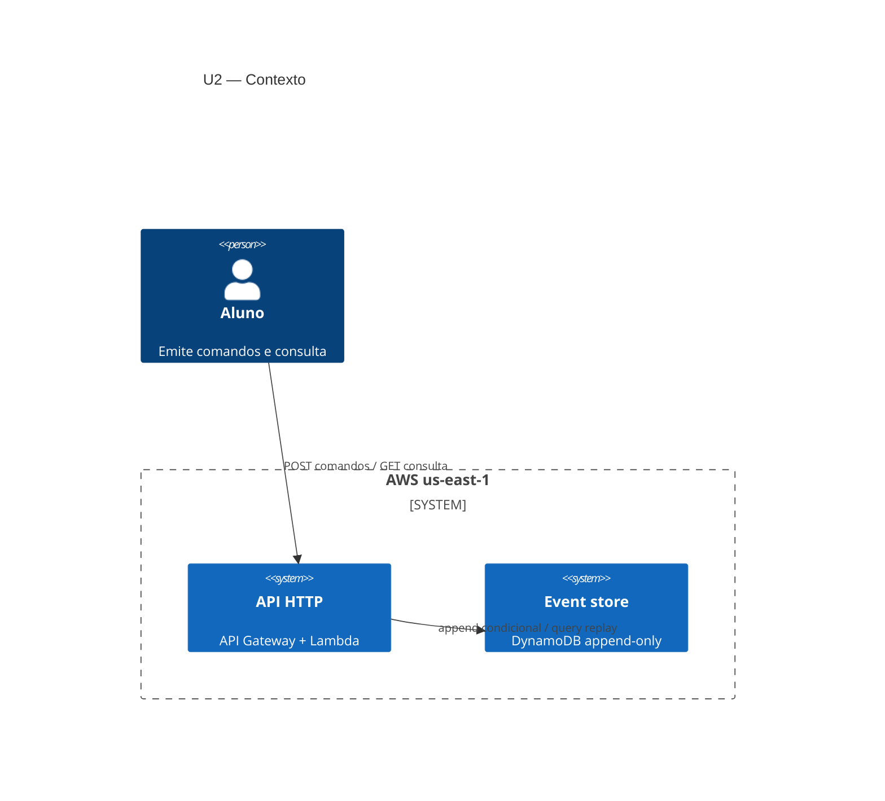
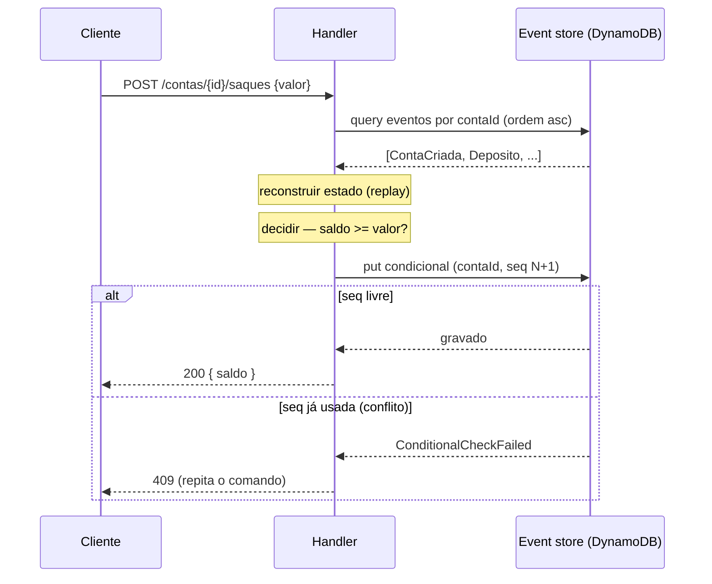
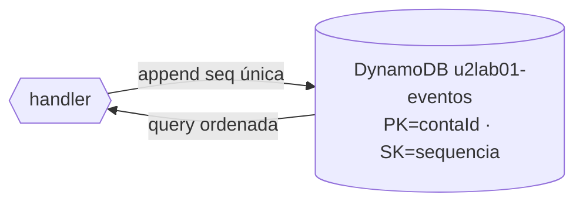
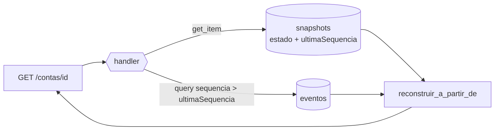
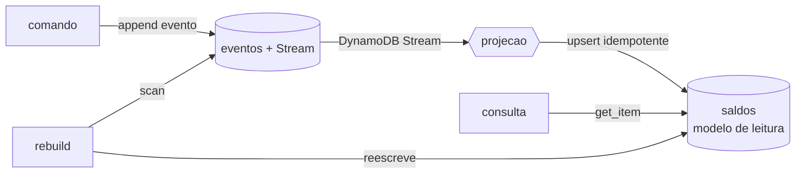

# Arquitetura — Unidade 2

Visão de arquitetura dos recursos exercitados nos laboratórios da Unidade 2 (Event Sourcing e CQRS).

## Contexto (C4 nível 1)

## Fluxo de comando (U2-LAB01)

## Topologia do event store

## Consulta com snapshot (U2-LAB02)

O snapshot dá o estado-base; só o delta de eventos é reprocessado. Snapshot é cache: se sumir, a consulta cai no replay completo.

## CQRS com projeção (U2-LAB03)

Escrita e leitura nunca se cruzam: o comando só grava eventos, a consulta só lê a projeção. O stream é o elo assíncrono (consistência eventual); o rebuild reconstrói a projeção a partir do store.

## Componentes por lab

| Recurso | U2-LAB01 | U2-LAB02 | U2-LAB03 |
|---------|:--------:|:--------:|:--------:|
| DynamoDB event store | ✓ | ✓ | ✓ |
| Lambda comando/consulta | ✓ | ✓ | ✓ |
| API Gateway (HTTP) | ✓ | ✓ | ✓ |
| Tabela de snapshots | — | ✓ | — |
| DynamoDB Streams | — | — | ✓ |
| Tabela de projeção (leitura) | — | — | ✓ |

## Decisões de arquitetura registradas

- **Event store em DynamoDB com chave `(contaId, sequencia)`** — a partição agrupa o agregado; a ordenação dá a sequência e habilita a query ordenada do replay.
- **Concorrência otimística por conditional write** — `attribute_not_exists` na sequência substitui a trava pessimista; conflito é raro e resolvido com retry (409), sem bloquear registros.
- **Dinheiro em `Decimal`, não float** — operações financeiras não toleram a imprecisão binária do float.
- **Comando e consulta juntos no U2-LAB01** — a separação CQRS só entra no U2-LAB03, quando há uma projeção de leitura para separar.
- **Snapshot em tabela separada, por `put_item` (U2-LAB02)** — snapshot é cache derivado, não evento; sobrescreve sem conditional write e é descartável (a consulta cai no replay completo se ele sumir).
- **Delta estritamente `sequencia > ultimaSequencia` (U2-LAB02)** — inclui o snapshot uma vez só; pegar `>=` reaplicaria o último evento e corromperia o saldo.
- **Projeção por DynamoDB Streams, não chamada síncrona (U2-LAB03)** — o comando publica o evento e segue; o stream alimenta a projeção de forma assíncrona (consistência eventual), escalando leitura e escrita separadamente.
- **`ConsistentRead=True` no lado de comando (U2-LAB03)** — calcular a próxima sequência exige ver os eventos recém-gravados; leitura eventualmente consistente causaria colisão de sequência.
- **Projeção idempotente por `ultimaSequencia` (U2-LAB03)** — o stream entrega *at-least-once*; reaplicar um evento já projetado não pode dobrar o saldo.
- **Transferência por `TransactWriteItems` (U2-LAB03)** — saque e depósito em agregados distintos são atômicos: ou os dois eventos entram, ou nenhum.

---

📑 [Índice](../index.md) · [Exercícios ➡️](../exercicios.md)
