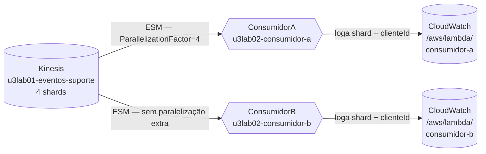

# U3-LAB02 — Consumidores Kinesis e at-least-once

Segundo laboratório da Unidade 3. Dois Lambdas independentes consomem o mesmo stream do LAB01 — cada um recebe **todos** os eventos, como consumer groups distintos no Kafka. ConsumidorA usa `ParallelizationFactor=4`; ConsumidorB não. `BisectBatchOnFunctionError` demonstra at-least-once e o isolamento de falhas.

## 1. Objetivos de aprendizagem

- **Reconhecer** que múltiplos Lambdas num mesmo stream recebem o stream completo cada um — não há particionamento de eventos entre eles.
- **Descrever** o que `ParallelizationFactor` faz dentro de um shard (paralelismo interno) e o que **não** faz (fan-out entre consumidores).
- **Explicar** at-least-once: o que significa, por que existe e qual é a contramedida correta (idempotência).
- **Identificar** como `BisectBatchOnFunctionError` isola um registro problemático sem bloquear os demais.
- **Diferenciar** `ParallelizationFactor` (mais invocações por shard, mesmo consumidor) de múltiplos ESMs (consumidores distintos, fan-out).

Base conceitual: [Consumidores e at-least-once](../01-fundamentos/2-consumidores-e-at-least-once.md).

## 2. Motivação

Um sistema de analytics e um sistema de alertas de SLA precisam reagir ao mesmo fluxo de tickets de suporte. Se compartilhassem uma SQS, cada evento seria consumido por apenas um dos dois — o outro perderia. Com dois ESMs no mesmo Kinesis stream, cada sistema recebe o fluxo completo e opera de forma independente: nenhum "rouba" eventos do outro, nenhum bloqueia o outro em caso de falha.

## 3. Estrutura

```
lab-u3-02/
├── template.yaml           # ConsumidorA (PF=4, Bisect=true) + ConsumidorB (Bisect=true)
├── src/
│   ├── suporte.py          # puro: decodificar_registro, decodificar_lote
│   └── consumidor.py       # handler: loga shard+clienteId; FalhaIntencional se FALHAR_EM
├── tests/                  # pytest (decodificação de registros Kinesis)
└── scripts/consumir-e-observar.sh
```

Requer o stream do U3-LAB01. Comandos via [`Makefile`](../../../Makefile) na raiz.

## 4. Topologia



O ponto a **reconhecer**: as duas setas saindo do stream não significam que os eventos são divididos. Cada ESM lê o stream inteiro — a seta representa um fluxo de cópia, não de particionamento.

## 5. Código anotado

`suporte.py` decodifica o formato do ESM:

```python
def decodificar_registro(registro):
    # eventID = "shardId-000000000001:49590338271490..."
    # A parte antes do ':' é o shardId
    shard_id = registro["eventID"].split(":")[0]
    dados = json.loads(base64.b64decode(registro["kinesis"]["data"]).decode("utf-8"))
    return {"shardId": shard_id, "dados": dados}
```

O `consumidor.py` demonstra a falha intencional para acionar o bisect:

```python
class FalhaIntencional(Exception):
    """Levantada intencionalmente para demonstrar at-least-once via retry do ESM."""

def lambda_handler(event, context):
    registros = decodificar_lote(event["Records"])
    for r in registros:
        cliente_id = r["dados"].get("clienteId", "?")
        print(f"[{CONSUMIDOR}] shard={r['shardId']} clienteId={cliente_id}")
        if FALHAR_EM and cliente_id == FALHAR_EM:
            raise FalhaIntencional(f"falha intencional para clienteId={cliente_id!r}")
```

`BisectBatchOnFunctionError: true` no template: quando a exceção é lançada, o ESM divide o lote ao meio e retenta. Se o lote tem 4 registros e o 3º falha, o ESM tenta [1,2], depois [3,4], depois [3], depois [4] — até isolar o registro problemático.

## 6. Rodar e observar

```bash
make deploy-consumidor   # implanta u3lab02-consumidores (requer u3lab01-produtor)
make consumidor          # executa o script em duas partes
```

**Parte 1 — dois consumidores recebem todos os eventos:**

```
▶ Parte 1 — dois consumidores independentes recebem todos os eventos
  5 evento(s) publicados. Aguardando processamento (25s)...

▶ Logs do CONSUMIDOR-A (ParallelizationFactor=4)
   [consumidor-a] shard=shardId-000000000001 clienteId=cli-001
   [consumidor-a] shard=shardId-000000000003 clienteId=cli-002
   ...

▶ Logs do CONSUMIDOR-B (sem paralelização adicional)
   [consumidor-b] shard=shardId-000000000001 clienteId=cli-001
   [consumidor-b] shard=shardId-000000000003 clienteId=cli-002
   ...

  Ambos receberam os mesmos eventos — como dois consumer groups distintos no Kafka.
```

**Parte 2 — bisect em ação:**

```
▶ Parte 2 — at-least-once: BisectBatchOnFunctionError em ação
  Configurando FALHAR_EM=cli-002 no consumidor-a...
  4 eventos publicados. Aguardando retentativas (45s)...

▶ Logs do CONSUMIDOR-A (observe bisect e retentativas para cli-002)
   [consumidor-a] shard=... clienteId=cli-001
   [consumidor-a] shard=... clienteId=cli-002   ← falha aqui
   ... (ESM bisecta e retenta)
   [consumidor-a] shard=... clienteId=cli-001   ← metade sem falha, sucesso
   [consumidor-a] shard=... clienteId=cli-002   ← lote isolado, falha de novo
   ...
```

## 7. Pontos de atenção

| Ponto | Detalhe |
|-------|---------|
| `ParallelizationFactor` ≠ fan-out | PF aumenta invocações simultâneas **no mesmo consumidor** para um shard. Não duplica eventos para outro sistema. |
| `FALHAR_EM` é só para a demo | A variável de ambiente `FALHAR_EM` é um mecanismo de laboratório. O script restaura o valor original ao final. |
| At-least-once ≠ exatamente-uma-vez | O ESM pode entregar o mesmo registro mais de uma vez após um retry. O consumidor deve ser idempotente em produção. |
| Bloquear o checkpoint | Sem `BisectBatchOnFunctionError`, uma falha persistente bloqueia o checkpoint do shard — novos registros não são processados enquanto o lote com falha não passar ou expirar. |

## 8. Checklist de compreensão

- [ ] Explico por que ConsumidorA e ConsumidorB recebem os **mesmos** eventos, não uma metade cada.
- [ ] Descrevo o que `ParallelizationFactor=4` muda no comportamento de um shard.
- [ ] Sei por que at-least-once implica que o consumidor deve ser idempotente.
- [ ] Identifico o que acontece com o checkpoint quando o Lambda lança exceção sem `BisectBatchOnFunctionError`.
- [ ] Entendo o caminho que o ESM percorre para isolar um único registro problemático com o bisect.

## 9. Limpeza

```bash
make clean    # remove todos os stacks (inclui u3lab02-consumidores) + artefatos locais
```

## 10. Referências

- Documentação AWS — "Event source mapping for Kinesis" e "BisectBatchOnFunctionError".
- *Designing Data-Intensive Applications* — Kleppmann, cap. 11 (consumer groups e fault tolerance).

---

⬅️ [Demo: U3-LAB01](u3-01.md) · 📑 [Índice](../index.md) · [Demo: U3-LAB03 ➡️](u3-03.md)
