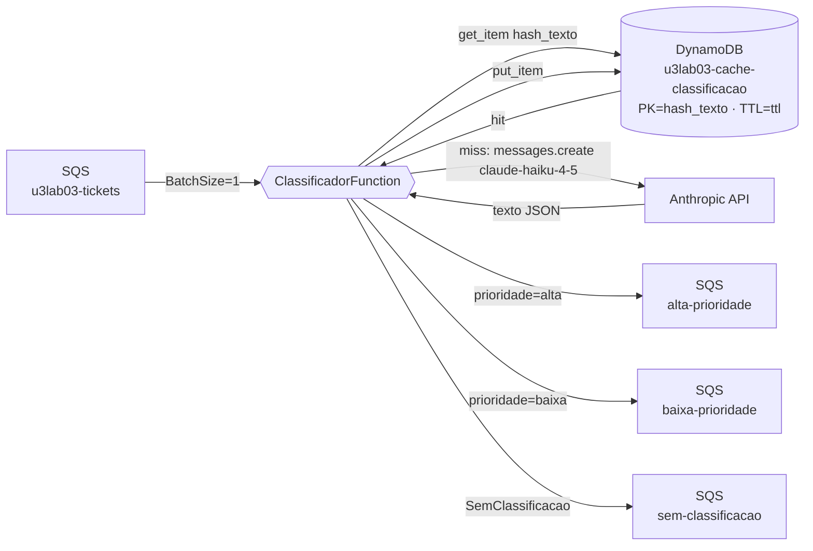

# U3-LAB03 — Classificador IA com cache DynamoDB

Terceiro laboratório da Unidade 3. Um Lambda recebe tickets de suporte via SQS, chama o Claude Haiku (Anthropic API) para classificar em prioridade e categoria, roteia para filas separadas e armazena o resultado em cache DynamoDB com TTL de 24h — eliminando chamadas repetidas à API para textos já processados.

## 1. Objetivos de aprendizagem

- **Descrever** o fluxo Lambda→API Anthropic→SQS: como o Lambda orquestra sem implementar a inteligência.
- **Identificar** o papel do cache DynamoDB: qual chave é usada, como o TTL funciona e quando o cache é consultado.
- **Explicar** por que o prompt exige saída em JSON estruturado e o que acontece quando o modelo não segue a instrução.
- **Diferenciar** [cache hit](../glossario.md#cache-hit) (resposta do DynamoDB, custo zero de LLM) de [cache miss](../glossario.md#cache-miss) (chamada à API Anthropic, ~500ms).

Base conceitual: [IA generativa e cache](../01-fundamentos/3-ia-generativa-e-cache.md).

## 2. Motivação

Equipes de suporte recebem centenas de tickets por dia. Classificar manualmente (prioridade, categoria) é lento e subjetivo. Um modelo de linguagem classifica em menos de 1 segundo com consistência. E quando o mesmo texto aparece novamente — renvio por retry, ticket duplicado, pergunta recorrente — o cache elimina o custo e a latência da chamada à API: a segunda ocorrência é tão rápida quanto ler uma linha do DynamoDB.

## 3. Estrutura

```
lab-u3-03/
├── template.yaml           # SQS (4 filas) + DynamoDB (cache TTL) + Lambda classificador
├── src/
│   ├── suporte.py          # puro: hash_texto, montar_prompt, parsear_resposta, calcular_ttl
│   ├── classificador.py    # handler: cache → API → parse → salva → roteia
│   └── requirements.txt    # anthropic>=0.49.0
├── tests/                  # pytest (hash, prompt, parsing, TTL — sem chamadas à API)
└── scripts/classificar-e-rotear.sh
```

Um stack SAM. Requer `ANTHROPIC_API_KEY` exportada no shell antes do deploy. Comandos via [`Makefile`](../../../Makefile) na raiz.

## 4. Topologia



O ponto a **identificar**: o DynamoDB é consultado **antes** da API. Só há chamada ao modelo se o hash do texto não for encontrado no cache.

## 5. Código anotado

`suporte.py` é puro — zero dependências externas, totalmente testável:

```python
def hash_texto(texto):
    # Chave determinística de cache: mesmo texto → mesmo hash → mesmo item no DynamoDB
    return hashlib.sha256(texto.encode("utf-8")).hexdigest()

def montar_prompt(texto):
    # Instrução explícita: JSON-only, sem markdown, sem texto adicional
    return (
        "Classifique este ticket de suporte. Responda APENAS com JSON válido, "
        "sem texto adicional, sem markdown:\n\n"
        f'"{texto}"\n\n'
        "Formato obrigatório: "
        '{"prioridade": "alta" ou "baixa", "categoria": "tecnico" ou "comercial"}'
    )

def parsear_resposta(texto_llm):
    dados = json.loads(texto_llm.strip())     # JSONDecodeError → SemClassificacao
    if dados.get("prioridade") not in ("alta", "baixa"):
        raise SemClassificacao(...)
    if dados.get("categoria") not in ("tecnico", "comercial"):
        raise SemClassificacao(...)
    return {"prioridade": dados["prioridade"], "categoria": dados["categoria"]}

def calcular_ttl(horas=24):
    return int(time.time()) + horas * 3600
```

`classificador.py` orquestra os serviços:

```python
def lambda_handler(event, context):
    for record in event["Records"]:
        ticket = json.loads(record["body"])
        chave = hash_texto(ticket.get("texto", ""))

        cache = _buscar_cache(chave)
        if cache:
            classificacao = {"prioridade": cache["prioridade"], "categoria": cache["categoria"]}
            origem = "cache"
        else:
            try:
                classificacao = _classificar_via_api(ticket["texto"])
                _salvar_cache(chave, classificacao)
            except SemClassificacao as e:
                print(f"[SEM-CLASSIFICACAO] {e}")
                classificacao = None
            origem = "api"

        _rotear(ticket, classificacao)
        print(f"[CLASSIFICADO] {origem} prioridade=... categoria=...")
```

## 6. Rodar e observar

```bash
export ANTHROPIC_API_KEY=<sua-chave>
make deploy-classificador   # implanta u3lab03-classificador
make classificador          # executa as duas partes do script
```

**Parte 1 — 10 tickets distintos → chamadas à API:**

```
▶ Parte 1 — 10 tickets distintos → chamadas à API Anthropic
  10 tickets enviados. Aguardando classificação (45s)...
  fila alta-prioridade:    6 mensagem(ns)
  fila baixa-prioridade:   4 mensagem(ns)
  fila sem-classificação:  0 mensagem(ns)
  total roteado: 10 / 10

▶ Logs (note 'api' — cada ticket chamou o Claude Haiku)
   [CLASSIFICADO] api prioridade=alta categoria=tecnico texto='Sistema fora do ar...'
   [CLASSIFICADO] api prioridade=baixa categoria=comercial texto='Quero cancelar...'
   ...
```

**Parte 2 — mesmos 10 tickets → cache hits:**

```
▶ Parte 2 — os mesmos 10 tickets → 0 chamadas à API (cache)
  10 tickets enviados. Aguardando (30s)...
  fila alta-prioridade:    6 mensagem(ns)
  fila baixa-prioridade:   4 mensagem(ns)
  fila sem-classificação:  0 mensagem(ns)

▶ Logs (note 'cache' — nenhuma chamada à API Anthropic foi feita)
   [CLASSIFICADO] cache prioridade=alta categoria=tecnico texto='Sistema fora do ar...'
   [CLASSIFICADO] cache prioridade=baixa categoria=comercial texto='Quero cancelar...'
   ...
```

## 7. Pontos de atenção

| Ponto | Detalhe |
|-------|---------|
| `ANTHROPIC_API_KEY` via variável de ambiente | Nunca commitar a chave. O deploy lê `$ANTHROPIC_API_KEY` do shell; o Lambda recebe como env var via parâmetro CloudFormation `NoEcho`. |
| `BatchSize=1` | Cada invocação processa um ticket. Simplifica o manejo de falha: se o Lambda falhar, só aquele ticket é retentado. |
| `VisibilityTimeout: 180` | A fila de entrada tem VisibilityTimeout de 6× o timeout do Lambda (30s × 6 = 180s). Evita que a mensagem reapareça enquanto ainda está sendo processada. |
| `SemClassificacao` é um resultado, não um bug | Quando o modelo retorna JSON inválido ou valores fora do domínio, o registro vai para `u3lab03-sem-classificacao` — não é descartado. Permite inspeção manual e reprocessamento. |

## 8. Checklist de compreensão

- [ ] Explico por que o SHA-256 do texto é a chave de cache e não o ticket inteiro.
- [ ] Identifico em qual parte do código a decisão cache/API é tomada e o que muda se o item expirar.
- [ ] Sei por que o prompt pede "APENAS com JSON válido" e o que acontece se o modelo desviar.
- [ ] Descrevo o caminho de um ticket desde a `FilaTickets` até a fila de destino — incluindo o caso de falha.
- [ ] Entendo por que `VisibilityTimeout` deve ser maior que o timeout do Lambda.

## 9. Limpeza

```bash
make clean    # remove todos os stacks (inclui u3lab03-classificador) + artefatos locais
```

## 10. Referências

- Documentação Anthropic — "Messages API" e "claude-haiku-4-5".
- Documentação AWS — "DynamoDB TTL" e "SQS visibility timeout".
- *Building LLM-Powered Applications* — prompt engineering para saída estruturada.

---

⬅️ [Demo: U3-LAB02](u3-02.md) · 📑 [Índice](../index.md) · [Demo: U3-KAFKA ➡️](u3-kafka.md)
