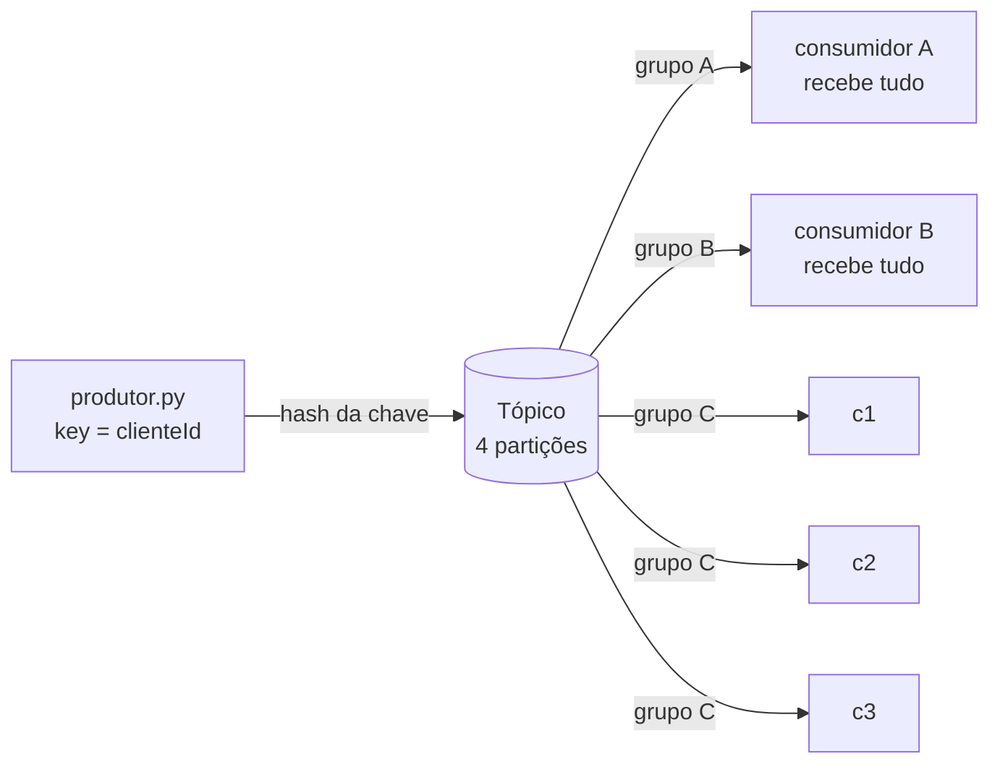

# U3-KAFKA — Kafka local em Docker: partições, consumer groups e reentrega

Trilha complementar aos U3-LAB01 e U3-LAB02. Os laboratórios Kinesis rodam na AWS (ou no LocalStack), e esta trilha executa Kafka real em um container Docker, sem conta AWS, para demonstrar os conceitos que os vídeos conceituais da unidade ensinam: chave de partição, consumer groups, rebalanceamento e entrega at-least-once.

## 1. Objetivos de aprendizagem

- **Explicar** por que a mesma chave cai sempre na mesma partição e como os offsets crescem dentro dela.
- **Diferenciar** dois consumer groups, em que cada um lê o tópico inteiro, de dois consumidores no mesmo grupo, que dividem as partições.
- **Observar** o rebalanceamento quando membros entram em um grupo, com 1, 2 e 3 consumidores sobre 4 partições.
- **Demonstrar** at-least-once: o commit do offset depois do processamento e a reentrega do registro que falhou.

Base conceitual: [Ponte: de Kafka para Kinesis](../01-fundamentos/kinesis-e-ia/3-ponte-kafka-kinesis.md) e [Consumidores e at-least-once](../01-fundamentos/2-consumidores-e-at-least-once.md).

## 2. Motivação

Os vídeos conceituais U3V1 a U3V3 ensinam Kafka, e os laboratórios Kinesis cobrem os mesmos conceitos com outro vocabulário. Esta trilha permite executar o próprio Kafka e mostra o rebalanceamento entre instâncias de um mesmo grupo, que o Event Source Mapping do Kinesis não expõe.

| Aspecto | Labs Kinesis (U3-LAB01 e U3-LAB02) | Trilha Kafka local |
|---------|------------------------------------|--------------------|
| Onde roda | AWS ou LocalStack | Docker local |
| Produtor | Lambda atrás de HTTP API | Script Python (`confluent-kafka`) |
| Consumidor | Lambda via ESM | Processo Python dentro de um grupo |
| Paralelismo | `ParallelizationFactor` | Mais consumidores no mesmo grupo |
| At-least-once | Retry do ESM e `BisectBatchOnFunctionError` | Commit depois do processamento e reentrega |
| Custo | AWS (ou LocalStack) | Nenhum |

## 3. Estrutura

```
lab-u3-kafka/
├── compose.yaml            # broker Kafka (KRaft, um nó) + criação do tópico
├── requirements.txt        # confluent-kafka
├── src/
│   ├── suporte.py          # puro: montar_evento, montar_lote, deve_falhar
│   ├── produtor.py         # key=clienteId → partição e offset de cada registro
│   └── consumidor.py       # membro de um grupo, commit depois de processar
├── tests/                  # pytest (sem broker e sem Docker)
└── scripts/
    ├── comum.sh
    ├── rotear-por-chave.sh
    ├── grupos-e-rebalanceamento.sh
    └── reentrega.sh
```

Os comandos ficam no [`Makefile`](../../../Makefile) da raiz. Cada demonstração cria um tópico próprio com 4 partições e o apaga ao terminar, de modo que execuções repetidas não herdam eventos nem offsets anteriores.

## 4. Topologia



Dentro do grupo C, cada partição é lida por um único membro, e a divisão é refeita sempre que um membro entra ou sai. Os grupos A e B leem o tópico inteiro de forma independente.

## 5. Código anotado

`suporte.py` é puro, sem `confluent_kafka`, e contém a regra da falha intencional:

```python
def deve_falhar(cliente_id, falhar_em):
    return bool(falhar_em) and cliente_id == falhar_em
```

`produtor.py` usa o `clienteId` como chave da mensagem, e o particionador do cliente calcula a partição a partir do hash dessa chave:

```python
producer.produce(
    TOPICO,
    key=evento["clienteId"],
    value=json.dumps(evento, ensure_ascii=False),
    on_delivery=ao_entregar(i, evento),
)
```

`consumidor.py` confirma o offset depois de processar cada registro, o que dá a semântica at-least-once:

```python
if deve_falhar(cliente_id, FALHAR_EM):
    print(f"[FALHA] ... (sem commit)", flush=True)
    return 1

print(f"[PROCESSADO] ...", flush=True)
consumer.commit(message=msg, asynchronous=False)
```

Com `enable.auto.commit=false`, nenhum offset é confirmado automaticamente, e um registro que falha antes da linha `commit` volta na próxima execução do mesmo grupo.

## 6. Rodar e observar

```bash
make kafka-up         # sobe o broker e cria o tópico u3kafka-eventos-suporte
make kafka-rotear     # roteamento por chave
make kafka-grupos     # consumer groups e rebalanceamento
make kafka-reentrega  # at-least-once com reentrega
make kafka-down       # derruba o broker e apaga os dados
```

O `make` instala o `confluent-kafka` no `.venv` na primeira execução. Os valores de partição, offset e a divisão de partições entre os membros variam entre execuções.

**Roteamento por chave.** A saída mostra a partição e o offset de cada registro e confirma que cada cliente usa uma única partição:

```
  clienteId  ->  partição  offset
  cli-001   ->  1          0
  cli-002   ->  3          0
  cli-001   ->  1          1
  cli-003   ->  1          2
  cli-002   ->  3          1
  cli-001   ->  1          3
  cli-003   ->  1          4

  resumo por cliente:
    cli-001: 1 partição(ões) -> OK, sempre a mesma partição, offsets crescentes
    cli-002: 1 partição(ões) -> OK, sempre a mesma partição, offsets crescentes
    cli-003: 1 partição(ões) -> OK, sempre a mesma partição, offsets crescentes
  partições distintas usadas pelos 3 clientes: 2 de 4
  ✓ mesma chave -> mesma partição -> ordenação por cliente
```

Neste exemplo, `cli-001` e `cli-003` caíram na mesma partição (a 1), e `cli-002` na partição 3. A colisão é esperada com apenas 4 partições.

**Grupos e rebalanceamento.** A Parte A mostra os grupos A e B recebendo os mesmos 5 eventos. A Parte B mostra a atribuição de partições a cada entrada de um novo membro e a atribuição final, com as 4 partições divididas entre c1, c2 e c3:

```
  Entra o consumidor c1 (sozinho no grupo)…
  [ATRIBUIDO] consumidor=c1 grupo=reb-29188 particoes=[0, 1, 2, 3]
  Entra o consumidor c2: o grupo é rebalanceado…
  [ATRIBUIDO] consumidor=c1 grupo=reb-29188 particoes=[2, 3]
  [ATRIBUIDO] consumidor=c2 grupo=reb-29188 particoes=[0, 1]
  Entra o consumidor c3: novo rebalanceamento…

▶ Atribuição final (última linha [ATRIBUIDO] de cada membro)
  [ATRIBUIDO] consumidor=c1 grupo=reb-29188 particoes=[3]
  [ATRIBUIDO] consumidor=c2 grupo=reb-29188 particoes=[2]
  [ATRIBUIDO] consumidor=c3 grupo=reb-29188 particoes=[0, 1]

  partições atribuídas no total: [0, 1, 2, 3]
  ✓ as 4 partições estão divididas entre os 3 membros, sem sobreposição
```

**Reentrega.** A execução 1 termina com `[FALHA]` no registro de cli-002, e a execução 2, no mesmo grupo, processa esse mesmo registro:

```
▶ Execução 1 — consumidor com FALHAR_EM=cli-002
  [FALHA] consumidor=exec-1 particao=3 offset=0 clienteId=cli-002 (sem commit)
  O processo terminou com código 1: a falha ocorreu antes do commit do cli-002.

▶ Execução 2 — mesmo grupo, sem falha intencional
  [PROCESSADO] consumidor=exec-2 particao=3 offset=0 clienteId=cli-002
  [PROCESSADO] consumidor=exec-2 particao=1 offset=0 clienteId=cli-001
  [PROCESSADO] consumidor=exec-2 particao=1 offset=1 clienteId=cli-001
  [PROCESSADO] consumidor=exec-2 particao=1 offset=2 clienteId=cli-003

  ✓ o registro de cli-002 (particao=3 offset=0) falhou antes do commit e foi entregue de novo
```

## 7. Pontos de atenção

| Sintoma | Causa | O que saber |
|---------|-------|-------------|
| Dois clientes na mesma partição | O hash da chave pode colidir | Normal com 4 partições. A distinção entre clientes é probabilística. |
| Um membro novo demora a receber partições | Rebalanceamento do grupo | Durante o rebalanceamento, os membros revogam e recebem as partições de novo. |
| O quinto consumidor do grupo não recebe nada | Cada partição tem um único membro por grupo | Com 4 partições, o grupo usa no máximo 4 membros. |
| O registro que falhou volta, e os seguintes também | O commit é por offset, e a partição recomeça do último offset confirmado | Por isso o processamento precisa ser idempotente. |
| `make kafka-up` não conecta | Docker ou Colima parado | Rodar `colima start` (ou abrir o Docker Desktop) e repetir. |
| `docker: 'compose' is not a docker command` | Falta o plugin Docker Compose v2 | Instalar o plugin e confirmar com `docker compose version` (ver [Setup local](../00-comece-aqui/setup-local.md)). |
| Porta 9092 ocupada | Outro processo usa a porta | Parar o processo ou o broker anterior com `make kafka-down`. |

## 8. Checklist de compreensão

- [ ] Explico por que a chave `clienteId` fixa a partição e garante a ordem por cliente.
- [ ] Diferencio dois grupos distintos de dois membros do mesmo grupo.
- [ ] Descrevo o que acontece com as partições quando um terceiro consumidor entra no grupo.
- [ ] Explico por que confirmar o offset depois de processar produz at-least-once.
- [ ] Relaciono o rebalanceamento do Kafka ao `ParallelizationFactor` e aos múltiplos ESMs do Kinesis.

## 9. Limpeza

```bash
make kafka-down    # derruba o container e remove o volume com os dados
```

## 10. Referências

- Documentação Apache Kafka: "Consumer Groups" e "Message Delivery Semantics".
- Documentação do `confluent-kafka-python`.
- *Designing Data-Intensive Applications*, Kleppmann, cap. 11 (stream processing).

---

⬅️ [Demo: U3-LAB03](u3-03.md) · 📑 [Índice](../index.md) · [Arquitetura ➡️](../03-arquitetura/arquitetura.md)
