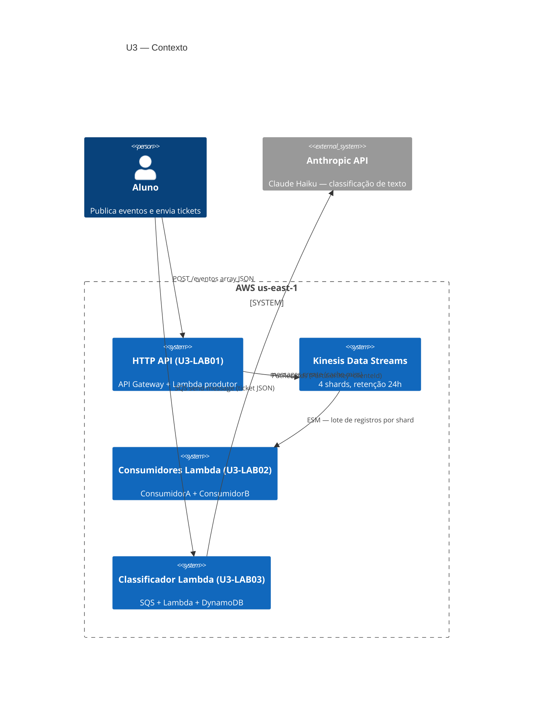
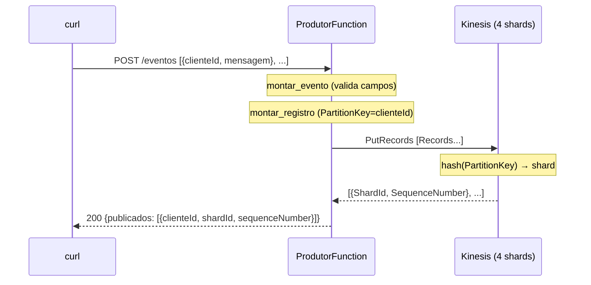
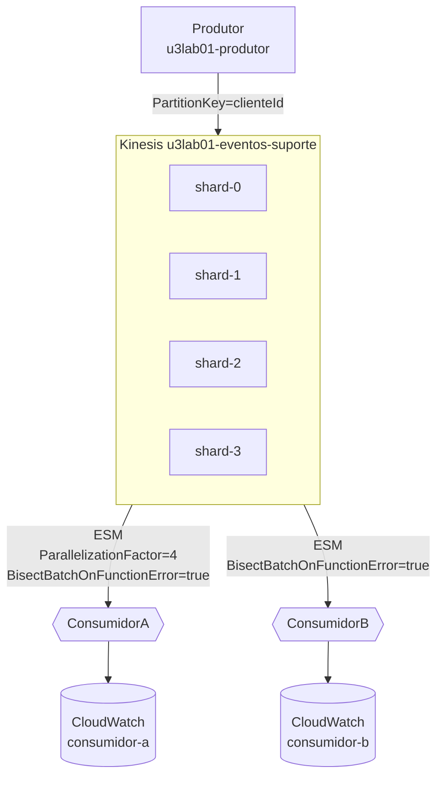
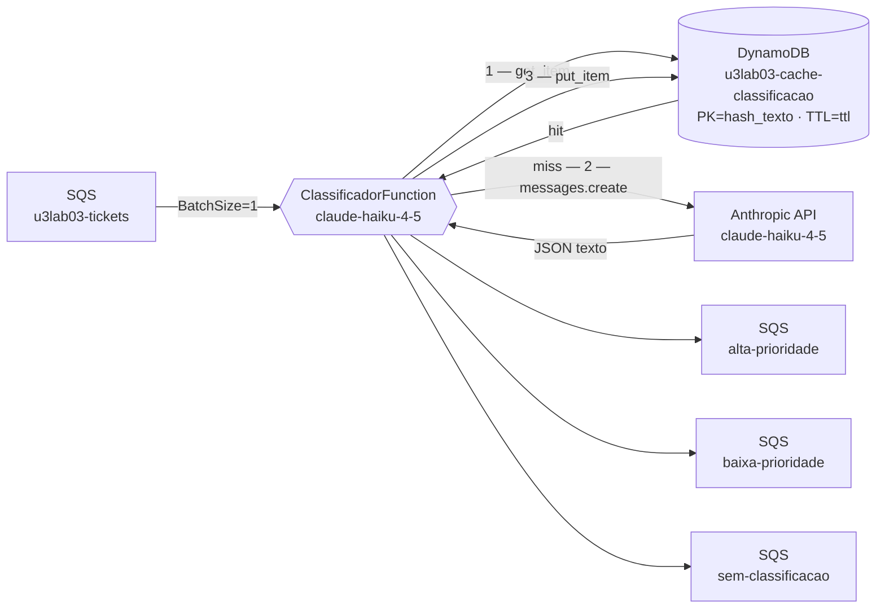
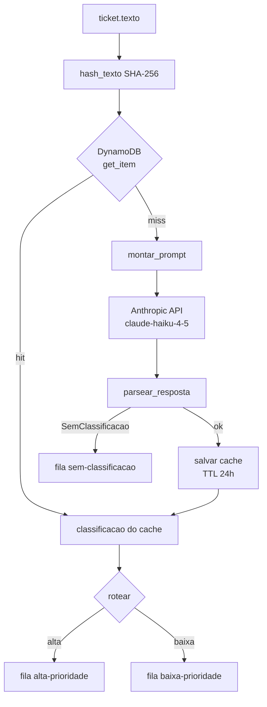

# Arquitetura — Unidade 3

Visão de arquitetura dos recursos exercitados nos laboratórios da Unidade 3 (Streaming, Consumidores e IA Generativa).

## Contexto (C4 nível 1)

## Fluxo do produtor (U3-LAB01)

## Topologia de shards e consumidores (U3-LAB02)

Cada seta do stream para o consumidor representa um ESM independente que lê o stream **inteiro** — os eventos não são divididos entre A e B.

## Pipeline do classificador IA (U3-LAB03)

## Fluxo de decisão cache/API

